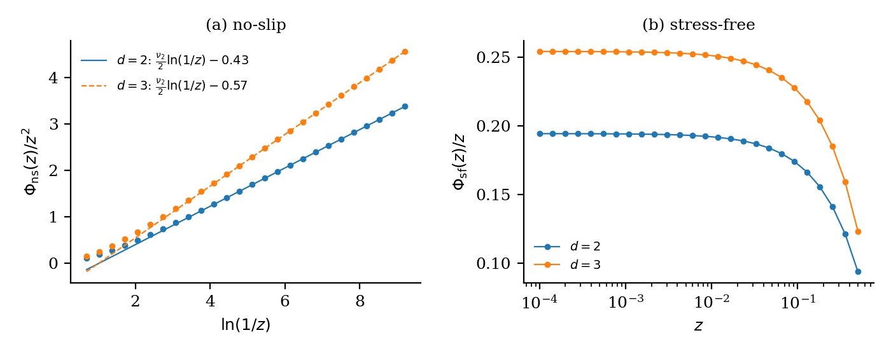
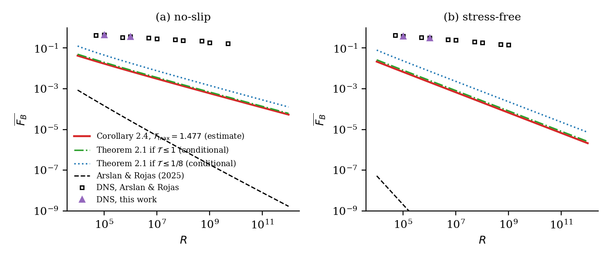
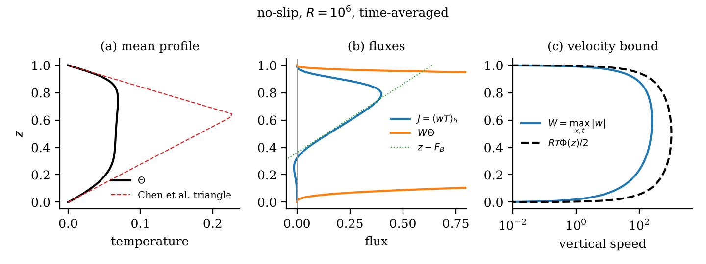
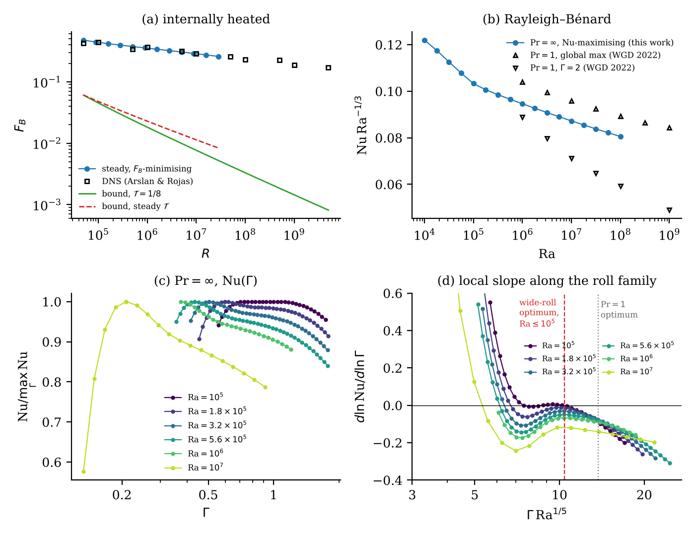

# 1 Introduction {#sec:intro}

Mantles and other planetary interiors are heated from within by radioactive decay. Their viscosity is so large that the Prandtl number is effectively infinite (about $10^{23}$ for the Earth’s mantle). The idealised model is uniform internally heated convection between two isothermal plates. Without flow, half the heat leaves through each plate. Convection breaks this symmetry: hot fluid rises, plumes of cold fluid descend from the unstable upper boundary layer, and a stably stratified layer forms at the base. The fraction $F_B$ of the heat that still leaves through the base measures how strongly convection redistributes heat upward. It plays a role similar to that of the Nusselt number in Rayleigh–Bénard convection (Goluskin, 2016).

Upper bound theory asks how small $F_B$ can be for *any* solution, steady or turbulent, as the flux Rayleigh number $R$ grows. That $F_B\ge0$ follows from the minimum principle (Goluskin & Spiegel, 2012). Quantitative bounds came much later. At arbitrary Prandtl number the best results are exponentially small in $R$ (Arslan et al., 2021; Kumar et al., 2022). At infinite Prandtl number, Arslan et al. (2023) proved $F_B\gtrsim R^{-2}$, and Arslan & Rojas (2025) improved this to $$F_B\ \gtrsim\ R^{-2/3}\quad\text{(no-slip)},\qquad F_B\ \gtrsim\ R^{-40/29}\quad\text{(stress-free)},$$ using the auxiliary-functional (background) method with the minimum principle imposed as a constraint. The companion bound on the mean temperature at infinite Prandtl number is $\langle T\rangle\ge0.419(R\log R)^{-1/4}$ (Whitehead & Doering, 2011), and rotating layers have also been treated (Arslan, 2024; Zhang et al., 2026). Chen et al. (2024) obtained the faster rate $F_B\ge 8.842R^{-1/3}$ at any Prandtl number, but only *conditionally*. Their Eq. (22), $\langle wT\rangle\le(\frac14-8.842R^{-1/3})^{1/2}$, combines the rigorous bound $\langle T\rangle\ge4.421R^{-1/3}$ of Lu et al. (2004) with the inequality $\langle T\rangle\le\frac18-\frac12\langle wT\rangle^2$ (their Eq. 21). That inequality rests on the hypothesis (their Eq. 14) that the mean temperature profile lies below the triangle $\min\{F_Bz,(1-z)(1-F_B)\}$, which they justify by a Taylor expansion at the walls and by simulations, and which they list among the limitations of their work. (Their text gives the approach of $\langle wT\rangle$ to $\tfrac12$ as $R^{-1/6}$; since $\tfrac12-\sqrt{1/4-x}\ge x$, Eq. (22) in fact implies $F_B\ge8.842R^{-1/3}$.) The two-dimensional simulations of Arslan & Rojas (2025) give $F_B\sim R^{-0.092}$ and $R^{-0.12}$. They observe that “whether any flow saturates the known bounds on $F_B$ remains an open question” and that further optimisation could improve the bounds. At finite Prandtl number, Goluskin & van der Poel (2016) found that the decrease of $F_B$ with $R$ reverses in the turbulent regime in two dimensions but continues in three. The problem has also been posed as item 3 of a recent list of open problems in geology suited to frontier models. That list notes, by contrast, that the basally heated (Rayleigh–Bénard) counterpart is now sharp. At infinite Prandtl number the bounds $\mathrm{Nu}\lesssim\mathrm{Ra}^{1/3}(\ln\mathrm{Ra})^{2/3}$ (Constantin & Doering, 1999), $\mathrm{Ra}^{2/5}$ from the background method (Doering & Constantin, 2001), $\mathrm{Ra}^{1/3}(\ln\mathrm{Ra})^{1/3}$ (Doering et al., 2006) and $\mathrm{Ra}^{1/3}(\ln\ln\mathrm{Ra})^{1/3}$ (Otto & Seis, 2011) were followed by $\mathrm{Nu}\lesssim\mathrm{Ra}^{1/3}$ without logarithms (Chanillo & Malchiodi, 2025), extended to Navier-slip walls by Seis (2026). It asks for two things: sharper bounds in the internally heated case, or flows that attain them; and a constructed solution of the basally heated problem with $\mathrm{Nu}\ge c\,\mathrm{Ra}^{1/3}$.

#### Results.

Our main contribution is to the first question. We prove (Theorem 2.1 and Corollary 2.4) that every classical solution satisfies $$\overline{F_B}\ \ge\ c\,(R\mathcal T\ln R\mathcal T)^{-1/3}\quad\text{(no-slip)},\qquad
\overline{F_B}\ \ge\ c\,(R\mathcal T)^{-1/2}\quad\text{(stress-free)},$$ where $\mathcal T$ is the long-time maximum temperature, and that $\mathcal T\le C(1+\ln|\Omega|)$ for every incompressible flow (Theorem 2.3). At fixed aspect ratio this improves the exponents of the best unconditional bounds from $2/3$ to $1/3$ (up to a logarithm) and from $40/29$ to $1/2$. In particular, at infinite Prandtl number the exponent $1/3$ of the conditional bound of Chen et al. (2024) is obtained, up to the logarithm, without their profile hypothesis. Our computed flows also let us test that hypothesis directly (Section 5). The flux argument does not use the energy identities on which the background method rests; only the temperature bound uses standard $L^p$ estimates. It has three steps:

1.  Because $T\ge0$, the horizontally averaged convective flux at height $z$ is at most the largest vertical speed at that height times the mean temperature there. This inequality is *linear* in the temperature.

2.  Near the base the infinite-Prandtl velocity obeys $|w|\le\tfrac12R\mathcal T\,\Phi(z)$. The wall function $\Phi$ is an explicit integral of $L^1$ norms of Green’s-function kernels, with $\Phi(z)=\tfrac12\nu_2z^2\ln(1/z)+O(z^2)$ for no-slip and $\Phi(z)\sim c_{\rm w}z$ for stress-free walls.

3.  Steps 1–2 turn the horizontally averaged heat balance into the differential inequality $\Theta'\le F_B-z+m(z)\Theta$ for the mean temperature profile $\Theta\ge0$, whose integrating factor gives an explicit lower bound on $F_B$.

We also determine the exact large-$R$ asymptotics of the bound functional, which give the best constants that inequality (5) can yield (Proposition 2.2). The constants depend on two norms of a slab correction to the half-space Green’s function. We prove that they are finite and evaluate them numerically, with numerical sensitivity checks, not uniform error enclosures and a second, more conservative route, but without interval certification (Section 2.5 lists what is proved and what is computed).

For the second half of each question (attainment and construction) we offer computations, not theorems. We solve the full infinite-Prandtl equations in two dimensions with a Fourier–Chebyshev time-stepper and a Newton solver for steady rolls, both validated against published linear thresholds and benchmark values to within the precision quoted for them.

- In simulated flows we test each inequality of the proof directly. Both hold with large margins, and the measured fluxes stay far above the bound. Near the base the convective flux is close to zero and in places negative, the reverse of what the extremal configuration needs.

- Steady internally heated rolls with the period chosen to minimise $F_B$ do essentially no better than the time-dependent simulations of Arslan & Rojas (2025): $F_B\approx1.29R^{-0.093}$ for $1.6\times10^6\le R\le2.8\times10^7$ (Section 6).

- For Rayleigh–Bénard convection at infinite Prandtl number, within the family of mirror-symmetric, layer-spanning rolls and the period range we scanned, the wide-roll maximum of Nu over the period, which yields $\mathrm{Ra}^{1/3}$ at $\mathrm{Pr}=1$ (Wen et al., 2022), is not detected above the sampled interval between $\mathrm{Ra}=10^5$ and $1.8\times10^5$. Above that, the largest maxima found are narrow rolls, which follow $\mathrm{Nu}\approx0.153\,\mathrm{Ra}^{0.298}$ with period $\Gamma^*\approx11.7\,\mathrm{Ra}^{-1/4}$ up to $\mathrm{Ra}=10^8$ (Section 6). This extends to infinite Prandtl number a trend that Sondak et al. (2015) found at $\mathrm{Pr}=10$ and $100$, where the narrow-roll maximum eventually overtakes the wide-roll one, and it matches the $\mathrm{Ra}^{3/10}$ scaling that Wen et al. (2026) derived for high-wavenumber rolls between stress-free walls. If the trend persists, two-dimensional steady rolls of this family will not attain the upper bound at infinite Prandtl number.

A rigorous construction remains open, and we explain why the structure of these rolls makes it hard.

#### Relation to earlier work.

The pointwise route to bounds at infinite Prandtl number goes back to Constantin & Doering (1999). They combined the maximum principle $0\le T\le1$ with a logarithmic estimate for the Stokes kernel to bound the Nusselt number in Rayleigh–Bénard convection. For internally heated convection every published bound on $F_B$ uses the background method. Even the recent work that uses pointwise velocity estimates (Arslan, 2024) applies them to individual Fourier modes inside a quadratic spectral constraint. The integrating-factor inequality (Lemma 3.1) and the resulting exponents were not found in the literature search recorded in the accompanying novelty report. That search traced the citation graphs of the internally heated bound papers and ran full-text and arXiv listing searches. Our temperature bound is a time-dependent slab variant of known $L^\infty$ estimates for incompressible drifts (Berestycki et al., 2010; Iyer et al., 2010).

# 2 Setting, notation and main results {#sec:setting}

## 2.1 The problem

Let $d\in\{2,3\}$ and $n=d-1$. The fluid occupies $\Omega=\mathbb{T}^n\times(0,1)$, where $\mathbb{T}^n=\prod_{i=1}^n[0,\Gamma_i)$ is a flat torus of periods $\Gamma_i>0$; points are written $(x,z)$ with $x\in\mathbb{T}^n$ the horizontal and $z$ the vertical coordinate, and $|\Omega|=\prod_i\Gamma_i$. In the nondimensionalisation of Arslan & Rojas (2025) (length $d$, time $d^2/\kappa$, temperature $d^2H/(\kappa\rho c_p)$), uniform internally heated convection at infinite Prandtl number is $$\begin{equation}
\tag{1}
\nabla\cdot u=0,\qquad -\Delta u+\nabla p=R\,T\,\hat z,\qquad
\partial_tT+u\cdot\nabla T=\Delta T+1 ,
\end{equation}$$ with $T=0$ on $z\in\{0,1\}$ and either no-slip ($u=0$) or stress-free ($w=\partial_z u_h=0$) walls, where $u=(u_h,w)$. The single control parameter is the flux Rayleigh number $R=g\alpha H d^5/(\rho c_p\nu\kappa^2)$. Throughout, $(u,T)$ denotes a global classical solution with bounded initial temperature. (We take existence for granted; for smooth data it follows from standard parabolic theory, because $u$ depends linearly on $T$ and is two derivatives smoother, and $T$ is bounded a priori by Theorem 2.3.) We write $\langle f\rangle_h(z,t)$ for the horizontal average, $\langle f\rangle$ for the volume average and $$F_B(t)=\partial_z\langle T\rangle_h\big|_{z=0},\qquad F_T(t)=-\partial_z\langle T\rangle_h\big|_{z=1}$$ for the heat fluxes out through the bottom and top plates. Long-time averages need not exist, so we fix the conventions $$\overline{F_B}=\liminf_{\tau\to\infty}\frac1\tau\int_0^\tau F_B\,dt,\qquad
\overline{F_T}=\limsup_{\tau\to\infty}\frac1\tau\int_0^\tau F_T\,dt,\qquad
\overline{\langle wT\rangle}=\limsup_{\tau\to\infty}\frac1\tau\int_0^\tau \langle wT\rangle\,dt .$$ Integrating the horizontally averaged heat equation over $z$, and against $1-z$, gives $$\begin{equation}
\tag{2}
\frac{d}{dt}\langle T\rangle=1-F_B-F_T,\qquad
\frac{d}{dt}\big\langle(1-z)T\big\rangle=\tfrac12-F_B-\langle wT\rangle .
\end{equation}$$ Since $T$ is bounded, the time averages of the left-hand sides tend to zero, so $\overline{F_B}+\overline{F_T}=1$ and $\overline{F_B}=\tfrac12-\overline{\langle wT\rangle}$ with these conventions (cf. Goluskin, 2016). Without flow, $F_B=F_T=\tfrac12$; convection carries heat upward and lowers $F_B$. The question posed in item 3 of the source bundle is how fast $\overline{F_B}$ can fall as $R\to\infty$.

Finally let $$\mathcal T=\limsup_{t\to\infty}\ \max_{\overline\Omega}T(\cdot,t)$$ denote the long-time maximum temperature. (For the conductive state $\mathcal T=1/8$.) Theorem 2.3 bounds $\mathcal T$ in terms of the volume of the *enlarged torus*: replacing each period $\Gamma_i$ by $\tilde\Gamma_i=\lceil1/\Gamma_i\rceil\Gamma_i\ge1$ and writing $\tilde\Omega=\prod_i[0,\tilde\Gamma_i)\times(0,1)$, a solution on $\Omega$ is also a solution on $\tilde\Omega$, with the same maximum, and $|\tilde\Omega|\ge1$. When every $\Gamma_i\ge1$, $\tilde\Omega=\Omega$.

## 2.2 Velocity kernels

For $\kappa\ge0$ and $z,s\in[0,1]$ let $g^{\rm bc}_\kappa(z,s)$ be the Green’s function of $(\partial_z^2-\kappa^2)^2$ on $(0,1)$ with clamped conditions $g=\partial_zg=0$ at $z=0,1$ (${\rm bc}={\rm ns}$, no-slip) or simply supported conditions $g=\partial_z^2g=0$ (${\rm bc}={\rm sf}$, stress-free). Define the symbol $m^{\rm bc}(\kappa;z,s)=\kappa^2g^{\rm bc}_\kappa(z,s)$, the horizontal kernel $K^{\rm bc}_{z,s}=\mathcal F^{-1}_{\mathbb R^n}\big[m^{\rm bc}(|\xi|;z,s)\big]$, and the *wall function* $$\begin{equation}
\tag{3}
\Phi_{\rm bc}(z)=\int_0^1\big\|K^{\rm bc}_{z,s}\big\|_{L^1(\mathbb R^n)}\,ds .
\end{equation}$$ We also use the constants $\nu_j=\big\|\mathcal F^{-1}_{\mathbb R^n}[|\xi|^je^{-|\xi|}]\big\|_{L^1(\mathbb R^n)}$; by scaling $\|\mathcal F^{-1}[|\xi|^je^{-c|\xi|}]\|_{L^1}=\nu_jc^{-j}$. In one dimension $\nu_0=1$, $\nu_1=2/\pi$, $\nu_2=3\sqrt3/(2\pi)$, $\nu_3=1.909859$; in two dimensions $\nu_0=1$, $\nu_1=4/(3\sqrt3)$, $\nu_2=1.115419$, $\nu_3=2.769323$ (Appendix B).

## 2.3 The bound functional

For a nonnegative integrable $m$ on $[0,1]$ put $M(z)=\int_0^zm$ and $$\begin{equation}
\tag{4}
\mathfrak B[m]=\frac{\int_0^1 z\,e^{-M(z)}\,dz}{\int_0^1e^{-M(z)}\,dz}\in\big(0,\tfrac12\big].
\end{equation}$$ $\mathfrak B[m]$ is the mean of the probability density proportional to $e^{-M}$ on $[0,1]$. If $m_1\le m_2$ pointwise then $e^{-M_2}/e^{-M_1}$ is nonincreasing, so the second density is smaller in likelihood-ratio order and $\mathfrak B[m_2]\le\mathfrak B[m_1]$: *any majorant of $m$ gives a valid lower bound.*

## 2.4 Main results

**Theorem 2.1** (bottom heat flux). Let $(u,T)$ be a classical solution of (1) with $T(\cdot,0)\ge0$. Then $$\begin{equation}
\tag{5}
\overline{F_B}\ \ge\ \mathfrak B\!\left[\tfrac12R\mathcal T\,\Phi_{\rm bc}\right].
\end{equation}$$ Consequently, with $\Lambda=\tfrac12R\mathcal T$:

1.  (no-slip) $\overline{F_B}\ge c_{\rm ns}\,(\Lambda\ln\Lambda)^{-1/3}$ for $\Lambda\ge e^3$;

2.  (stress-free) $\overline{F_B}\ge c_{\rm sf}\,\Lambda^{-1/2}$ for $\Lambda\ge 8/C'_{\rm sf}$.

Here $c_{\rm ns}=\frac{e-2}{e+2}\kappa_0$, where $\kappa_0>0$ is the largest $\kappa$ with $\kappa^3\big[7A+3B+3A\ln^+\!\frac1{2\kappa}\big]\le27$ (so that $\kappa_0=(27/(7A+3B))^{1/3}$ whenever $7A+3B\le216$), and $c_{\rm sf}=\frac{e-2}{e+2}(2/C'_{\rm sf})^{1/2}$, with $A$, $B$ and $C'_{\rm sf}$ the constants of Lemma 3.4. They depend only on $d$. With the computed values of the slab-correction constants (Section 5; numerical estimates, not interval-certified bounds), $c_{\rm ns}\approx0.205$ ($d=2$) and $0.187$ ($d=3$), and $c_{\rm sf}\approx0.270$ ($d=2$) and $0.245$ ($d=3$). Substituting sampled Carlson majorant maxima (not continuum upper enclosures) gives exploratory estimates $c_{\rm ns}\approx0.204$ and $0.186$, and $c_{\rm sf}\approx0.254$ and $0.226$.

The constants in (a)–(b) come from crude majorants of $\Phi_{\rm bc}$. The bound (5) itself is sharper, and its large-$\Lambda$ behaviour can be computed exactly:

**Proposition 2.2** (exact asymptotics of the bound functional). As $\Lambda\to\infty$, $$\mathfrak B[\Lambda\Phi_{\rm ns}]=\frac{\Gamma(2/3)}{\Gamma(1/3)}\Big(\frac{18}{\nu_2\,\Lambda\ln\Lambda}\Big)^{1/3}\big(1+o(1)\big),
\qquad
\mathfrak B[\Lambda\Phi_{\rm sf}]=\Big(\frac{2}{\pi c_{\rm w}\Lambda}\Big)^{1/2}\big(1+o(1)\big),$$ where $c_{\rm w}=\lim_{z\to0}\Phi_{\rm sf}(z)/z=\int_0^1\|\partial_zK^{\rm sf}_{z,s}|_{z=0}\|_{L^1}\,ds$. Numerically $c_{\rm w}\approx0.1944$ ($d=2$) and $0.2541$ ($d=3$), so that for large $\Lambda$ the right side of (5) is $\approx1.41(\Lambda\ln\Lambda)^{-1/3}$ (no-slip, $d=2$), $1.28(\Lambda\ln\Lambda)^{-1/3}$ (no-slip, $d=3$), $1.81\Lambda^{-1/2}$ (stress-free, $d=2$) and $1.58\Lambda^{-1/2}$ (stress-free, $d=3$).

Proposition 2.2 concerns the functional $\mathfrak B[\Lambda\Phi]$ only. It gives the best constants that (5) can yield; it says nothing about whether any solution comes close to the bound. The maximum temperature is controlled for every incompressible flow, whatever its origin:

**Theorem 2.3** (temperature bound). Let $u$ be smooth, divergence-free and tangential at $z\in\{0,1\}$ ($w=0$ there), and let $T$ solve $\partial_tT+u\cdot\nabla T=\Delta T+1$ in $\Omega$ with $T=0$ at $z\in\{0,1\}$ and $0\le T(\cdot,0)\in L^\infty$. Then $T\ge0$ and $$\begin{equation}
\tag{6}
\mathcal T\ \le\ \mathcal T_{\max}:=1+\frac{e}{2\pi^2}\max\big\{2,\ \ln\!\big(2^{d+1}|\tilde\Omega|\big)\big\}.
\end{equation}$$

For the two-dimensional simulations of Section 5 (period 4), for example, $\mathcal T_{\max}=1+\frac{e}{2\pi^2}\ln32\approx1.477$. Combining the two theorems, and using that $\mathfrak B[\Lambda\Phi]$ is nonincreasing in $\Lambda$, gives explicit bounds in terms of $R$ alone:

**Corollary 2.4**. Let $\Lambda_{\max}=\tfrac12R\,\mathcal T_{\max}$. For every classical solution with nonnegative initial temperature, $\overline{F_B}\ge\mathfrak B[\Lambda_{\max}\Phi_{\rm bc}]$, and in particular $$\begin{align*}
\overline{F_B}&\ \ge\ c_{\rm ns}\,(\Lambda_{\max}\ln\Lambda_{\max})^{-1/3}&&\text{(no-slip, }\Lambda_{\max}\ge e^3),\\
\overline{F_B}&\ \ge\ c_{\rm sf}\,\Lambda_{\max}^{-1/2}&&\text{(stress-free, }\Lambda_{\max}\ge8/C'_{\rm sf}).
\end{align*}$$ Since $\mathcal T_{\max}\le C(1+\ln|\tilde\Omega|)$, at fixed aspect ratio $\overline{F_B}\gtrsim(R\ln R)^{-1/3}$ (no-slip) and $\overline{F_B}\gtrsim R^{-1/2}$ (stress-free); equivalently $\overline{\langle wT\rangle}\le\tfrac12-c\,(R\ln R)^{-1/3}$ in the no-slip case.

At any fixed aspect ratio this improves the exponent of the best previous bounds, $F_B\gtrsim R^{-2/3}$ (no-slip) and $F_B\gtrsim R^{-40/29}$ (stress-free) (Arslan & Rojas, 2025), to $1/3$ (up to a logarithm) and $1/2$. The previous bounds are uniform in the aspect ratio. Ours lose a factor that grows only like a power of $\ln|\tilde\Omega|$, so they are stronger whenever $\ln|\tilde\Omega|\lesssim R/\ln R$ (no-slip) or $\ln|\tilde\Omega|\lesssim R^{51/29}$ (stress-free).

**Remark 2.5** (general initial data). If $T(\cdot,0)$ has a negative part, then $\|T_-(t)\|_\infty\le Ce^{-ct}$ (the proof of Theorem 2.3 shows this). Because $\langle w\rangle_h=0$, one has $\langle wT\rangle_h=\langle w(T+\varepsilon)\rangle_h\le \max|w|\,(\langle T\rangle_h+\varepsilon)$ whenever $T\ge-\varepsilon$, and the proof below goes through with an error that vanishes as $\varepsilon\to0$. So Theorem 2.1 holds for all bounded initial data.

## 2.5 What is proved and what is computed {#sec:status}

Table 1 sorts the results of this paper by the kind of evidence behind them.

::: {#tab:status}
| Result | Status |
|:---|:---|
| Theorem 2.1: inequality (5); exponents $\frac13$ (up to a logarithm) and $\frac12$ | Proved. Constants given by explicit formulas in $C_{\rm ns}$ and $C_{\rm sf}$, which are proved finite (Lemma 3.6). |
| Numerical values of $C_{\rm ns}$, $C_{\rm sf}$, $c_{\rm ns}$, $c_{\rm sf}$, $c_{\rm w}$ | Estimated using sensitivity checks and sampled Carlson majorants, without uniform error enclosures. Exact inequality $C_{\rm sf}\ge\nu_1/2$. |
| Proposition 2.2 | Proved; the stress-free prefactor uses the computed $c_{\rm w}$. |
| Theorem 2.3, Corollary 2.4 | Proved, with explicit constants. |
| Bound curves with $\mathcal T=1/8$ or $\mathcal T=1$ (Figure 2) | Conditional on that temperature ceiling. The exact formula with $\mathcal T=\mathcal T_{\max}$ is unconditional; all plotted evaluations are uncertified. |
| Simulations and steady rolls (Sections 5 and 6) | Two-dimensional computations. No claim of attainment, of global optimality over all steady solutions, or of asymptotic exponents. |
| Profile hypothesis of Chen et al. (2024) | Unproved. One finite-window profile violates the triangle off-grid; not a stationary counterexample. |

: Table 1. Status of the results.
:::

# 3 Lemmas {#sec:lemmas}

## 3.1 The integrating-factor inequality

**Lemma 3.1**. Let $(u,T)$ be a classical solution of the heat equation in (1) with $T\ge0$ on $\overline\Omega\times[t_0,t_0+\tau]$, and let $m\ge0$ be integrable on $[0,1]$ with $$|w(x,z,t)|\le m(z)\qquad\text{for all } x,\ z,\ t\in[t_0,t_0+\tau].$$ Then, with $\mathcal T_\tau=\max_{[t_0,t_0+\tau]}\max_{\overline\Omega}T$, $$\frac1\tau\int_{t_0}^{t_0+\tau}F_B(t)\,dt\ \ge\ \mathfrak B[m]-\frac{\mathcal T_\tau}{\tau}.$$

*Proof.* Averaging the heat equation horizontally and using $\nabla\cdot u=0$ gives $\partial_t\langle T\rangle_h+\partial_z\langle wT\rangle_h=\partial_z^2\langle T\rangle_h+1$. Integrate over $(0,z)$, using $w=0$ at $z=0$, and average over $[t_0,t_0+\tau]$. Writing $\Theta(z)$, $J(z)$ and $\bar F$ for the time averages of $\langle T\rangle_h(z,\cdot)$, $\langle wT\rangle_h(z,\cdot)$ and $F_B$, $$\begin{equation}
\tag{7}
\Theta'(z)=\bar F-z+J(z)+e(z),\qquad
e(z)=\frac1\tau\int_0^z\big[\langle T\rangle_h(\zeta,t_0+\tau)-\langle T\rangle_h(\zeta,t_0)\big]d\zeta,
\end{equation}$$ and $|e(z)|\le\mathcal T_\tau/\tau$ because both averages lie in $[0,\mathcal T_\tau]$. The key step uses the sign of $T$: since $T\ge0$, $$\langle wT\rangle_h(z,t)\le \max_x|w(x,z,t)|\,\langle T\rangle_h(z,t)\le m(z)\langle T\rangle_h(z,t),$$ and averaging in time gives $J\le m\Theta$. Hence $\Theta'\le \bar F+\mathcal T_\tau/\tau-z+m\Theta$. With $E=e^{-M}$, $M(z)=\int_0^zm$, this reads $(E\Theta)'\le E(\bar F+\mathcal T_\tau/\tau-z)$. Integrating over $[0,1]$ and using $\Theta(0)=0\le\Theta(1)$, $$0\le E(1)\Theta(1)\le\Big(\bar F+\frac{\mathcal T_\tau}{\tau}\Big)\int_0^1E-\int_0^1zE,$$ which is the claim. $\square$

The lemma uses only three facts: the minimum principle, the horizontally averaged heat balance, and a pointwise bound on $w$ that is linear in $T$. The energy identities on which the background method rests are not used. The flux $\langle wT\rangle_h$ is bounded *linearly* by the mean temperature, so the convective term enters (7) as a linear growth term rather than through a quadratic form. This is where the gain over the quadratic auxiliary functionals of Arslan & Rojas (2025) comes from.

**Lemma 3.2** (size of $\mathfrak B$). Let $m\ge0$ be nondecreasing on $[0,\tfrac12]$, and suppose $M(\tfrac12)\ge1$. Let $z_0\in(0,\tfrac12]$ be the point where $M(z_0)=1$. Then $\mathfrak B[m]\ge\frac{e-2}{e+2}\,z_0$. If instead $M(\tfrac12)<1$, then $\mathfrak B[m]\ge1/(8e)$.

*Proof.* $M$ is convex on $[0,\tfrac12]$ with $M(0)=0$, so $M(z)\le z/z_0$ on $[0,z_0]$ and $M(z)\ge z/z_0$ on $[z_0,\tfrac12]$; on $[\tfrac12,1]$, $M\ge M(\tfrac12)\ge 1/(2z_0)$. Thus $\int_0^1zE\ge\int_0^{z_0}ze^{-z/z_0}dz=z_0^2(1-2/e)$, while $\int_0^1E\le z_0+\int_{z_0}^\infty e^{-z/z_0}dz+\tfrac12e^{-1/(2z_0)}\le z_0(1+2/e)$, because $\tfrac12e^{-1/(2z_0)}=z_0\,xe^{-x}\le z_0/e$ with $x=1/(2z_0)\ge1$. The second statement follows from $E\ge e^{-1}$ on $[0,\tfrac12]$. $\square$

## 3.2 The near-wall velocity bound

**Lemma 3.3** (representation). For each $t$, $x$ and $z$, $$w(x,z,t)=R\int_0^1\int_{\mathbb R^n}K^{\rm bc}_{z,s}(x-y)\,T(y,s,t)\,dy\,ds$$ (with $T$ extended periodically in $y$). Consequently $|w(x,z,t)|\le\tfrac12R\,\big(\max T(\cdot,t)-\min T(\cdot,t)\big)\,\Phi_{\rm bc}(z)$.

*Proof.* Taking the curl twice of the Stokes equation gives $\Delta^2w=-R\Delta_hT$. For each horizontal wavevector $\kappa\ne0$ of the torus, the Fourier coefficient $\hat w_\kappa(z)$ therefore solves $(\partial_z^2-|\kappa|^2)^2\hat w_\kappa=R|\kappa|^2\hat T_\kappa$, with $\hat w_\kappa=\partial_z\hat w_\kappa=0$ at the walls (no-slip: $w=0$ and $\partial_zw=-\nabla_h\cdot u_h=0$) or $\hat w_\kappa=\partial_z^2\hat
w_\kappa=0$ (stress-free: $\partial_z^2w=-\nabla_h\cdot\partial_zu_h=0$). Hence $\hat w_\kappa(z)=R\int_0^1m^{\rm bc}(|\kappa|;z,s)\hat T_\kappa(s)\,ds$; and $\hat w_0=0$ because $\partial_z\langle w\rangle_h=0$ and $w=0$ at the walls, consistent with $m^{\rm bc}(0;z,s)=0$. By Poisson summation, convolution of a periodic function with $K_{z,s}\in L^1(\mathbb R^n)$ multiplies its Fourier coefficients by $m(|\kappa|;z,s)$, so both sides of the representation have the same coefficients and agree. Since $\int K_{z,s}=m(0;z,s)=0$, we may subtract from $T(\cdot,s,t)$ the midrange of $T(\cdot,t)$ before taking absolute values, which gives the factor $\tfrac12(\max T-\min T)$. $\square$

When $T\ge0$ and $T=0$ on the walls, $\max T-\min T=\max T$. The wall function satisfies:

**Lemma 3.4** (wall function). Let $z_*=\min(z,1-z)$. There are constants depending only on $d$ such that, for $z\in(0,1)$, $$\begin{align}
\Phi_{\rm ns}(z)&\le z_*^2\Big(A\ln\frac1{2z_*}+B\Big),\qquad A=\frac{5\nu_2+3\nu_1+\nu_3}{8},\quad
B=\frac32\nu_1+\frac12C_{\rm ns},\tag{8}\\
\Phi_{\rm sf}(z)&\le C'_{\rm sf}\,z_*,\qquad C'_{\rm sf}=\frac{\nu_1}2+C_{\rm sf},\tag{9}
\end{align}$$ where $C_{\rm ns},C_{\rm sf}<\infty$ are defined in (10) below. Moreover $\Phi_{\rm ns}(z)=\tfrac12\nu_2z^2\ln(1/z)+O(z^2)$ and $\Phi_{\rm sf}(z)=c_{\rm w}z\,(1+o(1))$ as $z\to0$.

The coefficient $\tfrac12\nu_2$ equals $3\sqrt3/(4\pi)=0.4135$ for $d=2$ and $0.5577$ for $d=3$. The logarithm is genuine: it comes from buoyancy at all heights $s$ between $z$ and $1$, each contributing about $\tfrac12\nu_2z^2/s$. It is the counterpart of the failure of $L^\infty\to W^{2,\infty}$ regularity for the Stokes system (Constantin & Doering, 1999).

*Proof.* By the reflection symmetry $z\mapsto1-z$ of the slab, $\Phi(z)=\Phi(1-z)$, so take $z\le\frac12$. Split $g=g^{\rm hs}+c$, where $g^{\rm hs}$ is the Green’s function of the half-space $z>0$ with the same wall conditions at $z=0$ and decay at infinity, and $c=g-g^{\rm hs}$ is the slab correction. Write $K=K^{\rm
hs}+K^{\rm c}$ accordingly. With $G_0(\zeta)=(1+\kappa|\zeta|)e^{-\kappa|\zeta|}/(4\kappa^3)$, the free-space Green’s function, one finds $g^{\rm hs,sf}=G_0(z-s)-G_0(z+s)$ and $$g^{\rm hs,ns}_\kappa(z,s)=\frac{(1+\kappa a)e^{-\kappa a}-(1+\kappa b+2\kappa^2zs)e^{-\kappa b}}{4\kappa^3},
\qquad a=|z-s|,\ b=z+s .$$ (Both formulas, and those below, were verified symbolically; Appendix A.)

*(i) Half-space part, all $s$.* Because $(1+\kappa a)e^{-\kappa a}-(1+\kappa b)e^{-\kappa
b}=\int_a^b\kappa^2c\,e^{-\kappa c}dc$, $$m^{\rm hs,ns}=\frac\kappa4\Big[\int_a^bc\,e^{-\kappa c}dc-2zs\,e^{-\kappa b}\Big],\qquad
m^{\rm hs,sf}=\frac\kappa4\int_a^bc\,e^{-\kappa c}dc .$$ Minkowski’s inequality and $\|\mathcal F^{-1}[\kappa e^{-c\kappa}]\|_1=\nu_1/c$ give $\|K^{\rm hs,ns}_{z,s}\|_1\le\frac{\nu_1}4\big[(b-a)+\frac{2zs}{z+s}\big]\le\nu_1\min(z,s)$ and $\|K^{\rm hs,sf}_{z,s}\|_1\le\frac{\nu_1}2\min(z,s)$.

*(ii) Half-space part, $s\ge2z$ (no-slip).* Since $m$ and $\partial_zm$ vanish at $z=0$, $m(\kappa;z,s)=\int_0^z(z-\zeta)\partial_\zeta^2m(\kappa;\zeta,s)\,d\zeta$. For $\zeta<s$, with $a=s-\zeta$ and $b=s+\zeta$, $$\partial_\zeta^2m^{\rm hs,ns}=\tfrac14\Big\{\kappa^2a\,e^{-\kappa a}-\kappa e^{-\kappa a}
-e^{-\kappa b}\big[\kappa^2(b-4s)+2s\kappa^3\zeta-\kappa\big]\Big\}.$$ For $\zeta\le s/2$ we have $a\ge s/2$, $s\le b\le 3s/2$ and $|b-4s|\le3s$, and the term-by-term $L^1$ norms sum to at most $(5\nu_2+3\nu_1+\nu_3)/(4s)$. Integrating in $\zeta$ gives $\|K^{\rm hs,ns}_{z,s}\|_1\le Az^2/s$.

*(iii) Slab correction.* Define $$\begin{equation}
\tag{10}
C_{\rm ns}=\sup_{0\le\zeta\le\frac12,\ 0\le s\le1}\big\|\mathcal F^{-1}[\kappa^2\partial_\zeta^2c^{\rm ns}_\kappa(\zeta,s)]\big\|_{L^1},\qquad
C_{\rm sf}=\sup_{0\le\zeta\le\frac12,\ 0\le s\le1}\big\|\mathcal F^{-1}[\kappa^2\partial_\zeta c^{\rm sf}_\kappa(\zeta,s)]\big\|_{L^1}.
\end{equation}$$ Taylor’s formula in $z$ (with $c=\partial_zc=0$ at $z=0$ for no-slip, and $c=0$ for stress-free) gives $\|K^{\rm c,ns}_{z,s}\|_1\le\tfrac12C_{\rm ns}z^2$ and $\|K^{\rm c,sf}_{z,s}\|_1\le C_{\rm sf}z$. Finiteness of $C_{\rm ns},C_{\rm sf}$ is proved in Lemma 3.6.

*(iv) Assembly.* For no-slip and $z\le\frac12$, $$\Phi_{\rm ns}(z)\le\nu_1\!\int_0^{2z}\!\min(z,s)\,ds+Az^2\!\int_{2z}^1\!\frac{ds}s+\tfrac12C_{\rm ns}z^2
=z^2\Big(A\ln\frac1{2z}+\frac32\nu_1+\frac12C_{\rm ns}\Big).$$ For stress-free, $\Phi_{\rm sf}(z)\le\frac{\nu_1}2\int_0^1\min(z,s)ds+C_{\rm sf}z\le C'_{\rm sf}z$.

*(v) Asymptotics.* Expanding one order further, $m^{\rm hs,ns}(\kappa;z,s)=\tfrac12z^2\kappa^2s\,e^{-\kappa s}+\int_0^z\tfrac12(z-\zeta)^2\partial_\zeta^3m^{\rm
hs,ns}d\zeta$, and $\partial_\zeta^3m^{\rm hs,ns}$ is again a finite sum of terms $p(\zeta,s)\kappa^je^{-\kappa
a}$, $p(\zeta,s)\kappa^je^{-\kappa b}$ whose $L^1$ norms are $O(s^{-2})$ for $\zeta\le s/2$. Hence $\|K^{\rm hs,ns}_{z,s}\|_1=\tfrac12\nu_2z^2/s+O(z^3/s^2)$ for $s\ge2z$. Integrating over $[2z,1]$ and adding the $O(z^2)$ contributions from (i) on $[0,2z]$ and from (iii) gives the stated expansion. For stress-free, $K^{\rm sf}_{z,s}/z\to\partial_zK^{\rm sf}_{z,s}|_{z=0}$ in $L^1$ for each $s>0$, and $\|K^{\rm sf}_{z,s}\|_1/z\le
C'_{\rm sf}$, so dominated convergence gives $\Phi_{\rm sf}(z)/z\to c_{\rm w}$. $\square$

**Lemma 3.5** ($L^1$ norms from weighted $L^2$ norms). Let $\varphi:[0,\infty)\to\mathbb R$ and $f=\mathcal F^{-1}_{\mathbb R^n}[\varphi(|\xi|)]$.

1.  ($n=1$) If $\varphi$ is continuous and piecewise $C^1$ with $I_j=\int_0^\infty|\varphi^{(j)}|^2d\kappa<\infty$ for $j=0,1$, then $\|f\|_{L^1(\mathbb R)}\le\sqrt2\,(I_0I_1)^{1/4}$.

2.  ($n=2$) If $\varphi(|\xi|)\in H^2(\mathbb R^2)$, then $\|f\|_{L^1(\mathbb R^2)}\le\big(\sqrt{J_0J_2}+J_1\big)^{1/2}$, where $J_0=\int_0^\infty\varphi^2\kappa\,d\kappa$, $J_1=\int_0^\infty\varphi'^2\kappa\,d\kappa$ and $J_2=\int_0^\infty(\varphi''+\varphi'/\kappa)^2\kappa\,d\kappa$.

*Proof.* For $\rho>0$ let $w_\rho(y)=(1+|y|^2/\rho^2)^n$. By Cauchy–Schwarz, $\|f\|_1^2\le\int w_\rho^{-1}\cdot\int w_\rho|f|^2$. For $n=1$, $\int w_\rho^{-1}=\pi\rho$, and Plancherel’s theorem gives $\|f\|_2^2=I_0/\pi$ and $\|yf\|_2^2=I_1/\pi$ (the even extension of $\varphi$ lies in $H^1(\mathbb R)$; a corner at $\kappa=0$ is allowed). So $\|f\|_1^2\le\rho I_0+I_1/\rho$; take $\rho=(I_1/I_0)^{1/2}$. For $n=2$, $\int w_\rho^{-1}=\pi\rho^2$, and $\|f\|_2^2$, $\||y|f\|_2^2$, $\||y|^2f\|_2^2$ equal $J_0$, $J_1$, $J_2$ divided by $2\pi$, because $|y|^2f$ is the inverse transform of $-\Delta_\xi\varphi(|\xi|)$ and $\Delta_\xi\varphi(|\xi|)=\varphi''+\varphi'/\kappa$. So $\|f\|_1^2\le\frac12(\rho^2J_0+2J_1+J_2/\rho^2)$; take $\rho^2=(J_2/J_0)^{1/2}$. $\square$

**Lemma 3.6** (slab correction). Put $\mu_{\rm ns}=\kappa^2\partial_\zeta^2c^{\rm ns}_\kappa(\zeta,s)$, $\mu_{\rm sf}=\kappa^2\partial_\zeta c^{\rm sf}_\kappa(\zeta,s)$ and $r_{\rm sf}=\mu_{\rm sf}+\frac s2\kappa e^{-\kappa}$, for $(\zeta,s)\in Q=[0,\frac12]\times[0,1]$.

1.  (Low frequencies.) $\mu_{\rm ns}=\kappa^2F_{\rm ns}$ and $r_{\rm sf}=\kappa^2F_{\rm sf}$, where each $F_{\rm bc}(\kappa;\zeta,s)$ is real-analytic in $\kappa\in\mathbb R$ and continuous, together with all its $\kappa$-derivatives, on $\mathbb R\times Q$. In particular $\mu_{\rm sf}=-\frac s2\kappa+O(\kappa^2)$. Explicitly, $$\mu_{\rm ns}=-s^2(2s\zeta-s-3\zeta+2)\,\kappa^2+s^2\kappa^3+O(\kappa^4),\qquad
    r_{\rm sf}=\tfrac16s(s^2+3\zeta^2-1)\,\kappa^2+O(\kappa^3).$$

2.  (High frequencies.) There are $C,p$ such that, for $\kappa\ge1$, $j\le2$ and $(\zeta,s)\in Q$, $|\partial_\kappa^j\mu_{\rm bc}|\le C(1+\kappa)^pe^{-\kappa(2-\zeta-s)}$ and $|\partial_\kappa^jr_{\rm sf}|\le
    C(1+\kappa)^pe^{-\kappa/2}$.

3.  Consequently, with the quantities of Lemma 3.5 computed for $\varphi=\mu_{\rm ns}$ and for $\varphi=r_{\rm sf}$, $$C_{\rm ns}\le\sup_Q\,\mathcal C[\mu_{\rm ns}]<\infty,\qquad
    \tfrac12\nu_1\le C_{\rm sf}\le\tfrac12\nu_1+\sup_Q\,\mathcal C[r_{\rm sf}]<\infty,$$ where $\mathcal C[\varphi]=\sqrt2(I_0I_1)^{1/4}$ for $n=1$ and $(\sqrt{J_0J_2}+J_1)^{1/2}$ for $n=2$.

The subtraction in $r_{\rm sf}$ is essential when $n=2$: the radial Laplacian of $|\xi|$ is $1/|\xi|$, which is not square-integrable near the origin of $\mathbb R^2$, so Lemma 3.5(b) cannot be applied to $\mu_{\rm sf}$ itself. For $n=1$ the cusp is harmless, but the subtraction still improves the bound.

*Proof.* *Structure.* Fix $s\in[0,1]$ and $\kappa>0$. The slab function $g_\kappa(\cdot,s)$ satisfies all four wall conditions, the half-space function $g^{\rm hs}_\kappa(\cdot,s)$ satisfies the two at $z=0$, and both solve $(\partial_z^2-\kappa^2)^2g=\delta_s$ on $(0,1)$ (for $s=1$ by continuity). Hence $c=g-g^{\rm hs}$ solves $(\partial_z^2-\kappa^2)^2c=0$ on $[0,1]$, with the bottom wall conditions and with $c(1)=-g^{\rm hs}(1,s)$, $\mathcal Bc(1)=-\mathcal Bg^{\rm hs}(1,s)$, where $\mathcal B=\partial_z$ (no-slip) or $\partial_z^2$ (stress-free). Let $u_0,\dots,u_3$ be the solutions with $u_j^{(k)}(0)=\delta_{jk}$, $0\le k\le3$. With $x=\kappa z$, $$u_1=z\sum_{k\ge0}\frac{(1-k)x^{2k}}{(2k+1)!},\qquad u_2=\frac{z^2}2\sum_{k\ge0}\frac{x^{2k}}{(2k+1)!},\qquad
u_3=z^3\sum_{k\ge1}\frac{k\,x^{2k-2}}{(2k+1)!},$$ so every $u_j$ and its $z$-derivatives are entire functions of $(\kappa,z)$, even in $\kappa$. The bottom conditions give $c=pu_2+qu_3$ (no-slip) or $c=pu_1+qu_3$ (stress-free), where $(p,q)$ solves a $2\times2$ system with matrix rows $(u(1))$ and $(\mathcal Bu(1))$. Its determinant $\Delta(\kappa)$ is an even entire function, equal to $1/12$ (no-slip) or $1$ (stress-free) at $\kappa=0$, and $\Delta(\kappa)\ne0$ for every real $\kappa$: otherwise there would be a nonzero $v$ satisfying all four homogeneous wall conditions with $(\partial_z^2-\kappa^2)^2v=0$, whereas $\int_0^1v\,(\partial_z^2-\kappa^2)^2v\,dz=\int_0^1|(\partial_z^2-\kappa^2)v|^2dz>0$. The data are explicit. With $a=1-s$ and $b=1+s$, for no-slip $$g^{\rm hs}(1,s)=\tfrac14e^{-\kappa b}\sum_{k\ge3}\Big[\frac{(2s)^k}{k!}+\frac{a(2s)^{k-1}}{(k-1)!}\Big]\kappa^{k-3},\qquad
\partial_zg^{\rm hs}(1,s)=\tfrac14e^{-\kappa b}\Big[2s^2-a\sum_{k\ge2}\frac{(2s)^k\kappa^{k-1}}{k!}\Big],$$ both entire in $\kappa$. For stress-free walls $g^{\rm hs}(1,s)=\frac{s}{2\kappa}e^{-\kappa b}+h_0(\kappa,s)$ and $\partial_z^2g^{\rm hs}(1,s)=h_2(\kappa,s)$ with $h_0$, $h_2$ entire in $\kappa$ (expand $G_0(1\mp s)$ in powers of $\kappa$).

*(i)* For no-slip, $\mu_{\rm ns}=\kappa^2\big(p\,\partial_\zeta^2u_2+q\,\partial_\zeta^2u_3\big)$ is $\kappa^2$ times a function that is analytic in $\kappa$ near the real axis, because $p,q$ are quotients of entire functions with denominator $\Delta\ne0$. For stress-free walls, the only term of $c$ that is not of this form is $-\frac{s}{2\kappa}e^{-\kappa b}v_0(\zeta;\kappa)$, where $v_0=p_0u_1+q_0u_3$ is the solution with $v_0(1)=1$, $\partial_z^2v_0(1)=0$. Since $v_0(\zeta;0)=\zeta$, its contribution to $\mu_{\rm sf}$ is $-\frac s2\kappa e^{-\kappa b}\partial_\zeta v_0=-\frac s2\kappa+O(\kappa^2)$, and $-\frac s2\kappa\big[e^{-\kappa b}\partial_\zeta v_0-e^{-\kappa}\big]$ is $\kappa^2$ times an analytic function. The coefficients of these power series are polynomials in $(\zeta,s)$, which gives joint continuity. The displayed coefficients were obtained by expanding the closed forms of Appendix A with computer algebra.

*(ii)* For $\kappa\ge1$ expand $c$ in the decaying basis $\phi_1=e^{-\kappa z}$, $\phi_2=\kappa ze^{-\kappa z}$, $\phi_3=e^{-\kappa(1-z)}$, $\phi_4=\kappa(1-z)e^{-\kappa(1-z)}$. After the derivative conditions are divided by $\kappa$ (no-slip) or $\kappa^2$ (stress-free), the four wall conditions read $(M_0+e^{-\kappa}N(\kappa))\,{\bf c}=
{\bf d}$. Here $M_0$ is a constant invertible matrix, block-diagonal with respect to the pairs $(\phi_1,\phi_2)$ and $(\phi_3,\phi_4)$; $N(\kappa)$ has polynomial entries; and ${\bf d}=(0,0,d_3,d_4)$ with $|d_i|\le C(1+\kappa)^pe^{-\kappa(1-s)}$ by the closed forms of $g^{\rm hs}$. These statements remain true for complex $\kappa'$ in a strip $|\mathrm{Im}\,\kappa'|\le\delta$, with $e^{-\kappa}$ replaced by $e^{-\mathrm{Re}\,\kappa'}$, so by Cauchy’s estimates it suffices to bound the functions themselves. For $\mathrm{Re}\,\kappa'\ge\kappa_*$ the Neumann series for $(I+M_0^{-1}e^{-\kappa'}N)^{-1}$ converges, and since $M_0^{-1}{\bf d}$ has no component on $(\phi_1,\phi_2)$, $|c_1|+|c_2|\le C(1+|\kappa'|)^pe^{-\mathrm{Re}\,\kappa'}|{\bf d}|$ and $|c_3|+|c_4|\le C|{\bf d}|$. On the compact part $1-\delta\le\mathrm{Re}\,\kappa'\le\kappa_*+\delta$ the same bounds hold with a larger $C$, because the determinant of the system is a nonzero multiple of $\Delta$ on the real axis and so, for $\delta$ small, does not vanish on the strip. Finally $|\partial_z^k\phi_i(\zeta)|\le C(1+\kappa)^{k+1}e^{-\kappa\zeta}$ for $i=1,2$ and $\le C(1+\kappa)^{k+1}e^{-\kappa(1-\zeta)}$ for $i=3,4$, so $|\mu_{\rm bc}|\le C(1+\kappa)^p\big[e^{-\kappa(2-s+\zeta)}+e^{-\kappa(2-s-\zeta)}\big]$, and $2-s-\zeta\ge\frac12$ on $Q$. The term $\frac s2\kappa e^{-\kappa}$ decays faster.

*(iii)* By (i), $\varphi=\mu_{\rm ns}$ and $\varphi=r_{\rm sf}$ have the form $\kappa^2F$ with $F,F',F''$ bounded near $\kappa=0$, so $\varphi(|\xi|)\in W^{2,\infty}_{\rm loc}(\mathbb R^n)$; by (ii) it decays exponentially together with two derivatives. Hence $\varphi(|\xi|)\in H^2(\mathbb R^n)$, the integrals $I_j$, $J_j$ are finite, and by dominated convergence they depend continuously on $(\zeta,s)\in Q$, so they are bounded on $Q$. Lemma 3.5 bounds $\|\mathcal F^{-1}\mu_{\rm ns}\|_1$ and $\|\mathcal F^{-1}r_{\rm sf}\|_1$, and $\|\mathcal F^{-1}[\frac s2\kappa e^{-\kappa}]\|_1=\frac s2\nu_1\le\frac12\nu_1$. For the lower bound take $(\zeta,s)=(0,1)$. Then $g^{\rm sf}(\cdot,1)=0$, so $c=-[G_0(\zeta-1)-G_0(\zeta+1)]$ and, since $\partial_\lambda G_0(\lambda)=
-\lambda e^{-\kappa|\lambda|}/(4\kappa)$, $\mu_{\rm sf}(\kappa;0,1)=-\frac12\kappa e^{-\kappa}$, whose kernel has $L^1$ norm $\frac12\nu_1$. $\square$

The proof shows finiteness and gives a computable majorant. Numerically (Section 5), $C_{\rm ns}\approx0.8615$ ($d=2$) and $1.172$ ($d=3$), attained at $\zeta=0$ with $s\approx0.91$ ($d=2$) and $0.90$ ($d=3$), that is, for buoyancy just below the top plate; the sampled Carlson majorant maxima are approximately $0.970$ and $1.303$. For stress-free walls the computed supremum is attained at the corner $(\zeta,s)=(0,1)$, where the norm equals $\frac12\nu_1$ exactly: $C_{\rm sf}\approx1/\pi$ ($d=2$) and $2/(3\sqrt3)$ ($d=3$) to the accuracy of the computation, against sampled majorant maxima $0.403$ and $0.526$. We have not proved that the supremum is attained at the corner. For $d=2$ the computed values give $A=0.994$ and $B\approx1.386$; for $d=3$, $A=1.332$ and $B\approx1.741$.

## 3.3 The temperature bound

*Proof of Theorem 2.3.* Extending $T$ and $u$ periodically, we may work on $\tilde\Omega$, so assume $\Gamma_i\ge1$ for all $i$ and write $|\Omega|$ for $|\tilde\Omega|$.

*Minimum principle.* $T\ge0$ by the parabolic maximum principle, since the source is nonnegative and $T=0$ on the walls.

*$L^p$ bounds independent of $u$.* For $p\ge2$, multiplying by $T^{p-1}$ and integrating, the advection term vanishes because $\int u\cdot\nabla(T^p)=0$ for divergence-free tangential $u$. This gives $\frac d{dt}\int T^p=-\frac{4(p-1)}{p}\int|\nabla T^{p/2}|^2+p\int T^{p-1}$. The one-dimensional Poincaré inequality in $z$ gives $\int|\nabla T^{p/2}|^2\ge\pi^2\int T^p$, and Hölder gives $\int T^{p-1}\le|\Omega|^{1/p}\|T\|_p^{p-1}$. Hence $Y=\|T\|_p$ satisfies $Y'\le-\lambda_pY+|\Omega|^{1/p}$ with $\lambda_p=4\pi^2(p-1)/p^2$, and $$\begin{equation}
\tag{11}
\limsup_{t\to\infty}\|T(t)\|_p\le\frac{p^2}{4\pi^2(p-1)}|\Omega|^{1/p}\le\frac{p}{2\pi^2}|\Omega|^{1/p}.
\end{equation}$$

*An explicit Nash-type inequality* (Nash, 1958). For $f\in H^1(\Omega)$ vanishing at $z\in\{0,1\}$ and every $\rho\ge\pi$, $$\begin{equation}
\tag{12}
\|f\|_2^2\le2^d\Big(\frac\rho\pi\Big)^d\|f\|_1^2+\rho^{-2}\|\nabla f\|_2^2 .
\end{equation}$$ To see this, expand $f$ in the orthonormal basis $|\mathbb T^n|^{-1/2}e^{ik\cdot x}\sqrt2\sin(j\pi z)$, $k\in\Lambda^*=\prod_i(2\pi/\Gamma_i)\mathbb Z$, $j\ge1$. Each coefficient is at most $(2/|\Omega|)^{1/2}\|f\|_1$ in modulus. Modes with $|k|^2+j^2\pi^2>\rho^2$ contribute at most $\rho^{-2}\|\nabla f\|_2^2$. The others number at most $(\rho/\pi)\,|\Omega|\,(\rho/\pi+1)^n\le2^n(\rho/\pi)^d|\Omega|$, because $j\le\rho/\pi$ and each coordinate of $k$ takes at most $\rho\Gamma_i/\pi+1\le\Gamma_i(\rho/\pi+1)$ values.

*Smoothing independent of $u$.* Let $S(t,\sigma)$ be the solution operator, from time $\sigma$ to time $t$, of $\partial_t\theta+u\cdot\nabla\theta=\Delta\theta$ with $\theta=0$ on the walls. It preserves positivity, satisfies $S1\le1$, does not increase $L^1$ norms, and $\frac d{dt}\|\theta\|_2^2=-2\|\nabla\theta\|_2^2$. Fix $\theta_0$, put $m=\|\theta_0\|_1$ and $y(t)=\|S(t,\sigma)\theta_0\|_2^2$, which is nonincreasing. While $y\ge2^{d+1}m^2$, choose $\rho=\pi\big(y/(2^{d+1}m^2)\big)^{1/d}\ge\pi$ in (12); then $\|\nabla\theta\|_2^2\ge\rho^2y/2$, so $Y=y/(2^{d+1}m^2)$ satisfies $Y'\le-\pi^2Y^{1+2/d}$. If $Y(t)\ge1$, then $Y\ge1$ on $[\sigma,t]$, and integrating gives $Y(t)\le\big(d/(2\pi^2(t-\sigma))\big)^{d/2}$. Hence $Y(t)\le1$ whenever $t-\sigma\ge d/(2\pi^2)$, which is less than $\frac12$ for $d\le3$, and $$\|S(t,\sigma)\|_{1\to2}\le2^{(d+1)/2}\qquad(t-\sigma\ge\tfrac12).$$ The $L^2$-adjoint of $S(t,\sigma)$ is the solution operator of the backward problem $-\partial_\tau\phi-u\cdot\nabla\phi
=\Delta\phi$, run from $\tau=t$ down to $\tau=\sigma$. After the time reversal $\tau\mapsto t+\sigma-\tau$ it is the forward problem with the drift $-u(\cdot,t+\sigma-\tau)$, which is again divergence-free and tangential. So $\|S(t,\sigma)\|_{2\to\infty}=\|S(t,\sigma)^*\|_{1\to2}\le2^{(d+1)/2}$ as well, and $\|S(t,t-1)\|_{1\to\infty}\le\|S(t,t-\frac12)\|_{2\to\infty}\|S(t-\frac12,t-1)\|_{1\to2}\le2^{d+1}=:N_d$. For $f\ge0$, Hölder’s inequality for positive operators with $S1\le1$ gives $Sf\le\big(S(f^p)\big)^{1/p}$, so $\|S(t,t-1)\|_{p\to\infty}\le N_d^{1/p}$.

*Conclusion.* By Duhamel’s formula $T(t)=S(t,t-1)T(t-1)+\int_{t-1}^tS(t,\sigma)1\,d\sigma\le N_d^{1/p}\|T(t-1)\|_p+1$. With (11), $\mathcal T\le1+\frac p{2\pi^2}(N_d|\Omega|)^{1/p}$. The choice $p=\max\{2,\ln(N_d|\Omega|)\}$ makes the last factor at most $e$. The same estimates applied to $T_-$, which is a subsolution of the homogeneous problem, show that the negative part of general initial data decays exponentially. $\square$

The logarithmic growth with $|\tilde\Omega|$ comes from the global $L^p$ estimates. For steady flows, rearrangement methods (Iyer et al., 2010; Talenti, 1976) give other bounds, which we do not pursue. Whether $\mathcal T$ is bounded uniformly in the aspect ratio for every incompressible flow is an open question. For the flows computed in Sections 5 and 6, the maximum temperature over every averaging window, and in every steady state, is below the conductive value $1/8$. That is an observation about finite time windows, not a bound on $\mathcal T$.

# 4 Proofs of the main results {#sec:proofs}

*Proof of Theorem 2.1.* Fix $\varepsilon>0$ and choose $t_0$ with $\max T(\cdot,t)\le\mathcal T+\varepsilon$ for $t\ge t_0$. By Lemma 3.3, and since $\max T-\min T=\max T$, the function $m=\tfrac12R(\mathcal
T+\varepsilon)\Phi_{\rm bc}$ satisfies the hypothesis of Lemma 3.1 on every window $[t_0,t_0+\tau]$. Hence $\frac1\tau\int_{t_0}^{t_0+\tau}F_B\ge\mathfrak B[m]-(\mathcal T+\varepsilon)/\tau$. Since $F_B$ is bounded on $[0,t_0]$, taking the lower limit as $\tau\to\infty$ gives $\overline{F_B}\ge\mathfrak B[m]$. Letting $\varepsilon\to0$ and using the continuity of $\Lambda\mapsto\mathfrak B[\Lambda\Phi]$ (dominated convergence) proves (5).

\(a\) By Lemma 3.4 and monotonicity of $\mathfrak B$, $\overline{F_B}\ge\mathfrak B[\Lambda\Psi]$ with $\Psi(z)=z_*^2(A\ln\frac1{2z_*}+B)$. $\Psi$ is nondecreasing on $(0,\frac12]$ because $\Psi'(z)=z(2A\ln\frac1{2z}+2B-A)$ and $2B\ge3\nu_1\ge A$ (with the values of $\nu_j$ in Section 2.2). Its primitive is $\int_0^z\Psi=\frac{z^3}3(A\ln\frac1{2z}+\frac A3+B)$ for $z\le\frac12$. Let $\Lambda\ge e^3$, $\kappa_0$ as in the theorem, and $\zeta=\kappa_0(\Lambda\ln\Lambda)^{-1/3}$. Then $\ln\frac1{2\zeta}=\frac13\ln(\Lambda\ln\Lambda)+\ln\frac1{2\kappa_0}\le\frac23\ln\Lambda+\ln^+\frac1{2\kappa_0}$, so $$\Lambda\int_0^\zeta\Psi\le\frac{\kappa_0^3}{3}\Big(\frac{2A}3+\frac{A\ln^+(1/2\kappa_0)+A/3+B}{\ln\Lambda}\Big)
\le\frac{\kappa_0^3}{27}\Big(7A+3B+3A\ln^+\frac1{2\kappa_0}\Big)\le1 ,$$ using $\ln\Lambda\ge3$. (The function $\kappa\mapsto\kappa^3[7A+3B+3A\ln^+\frac1{2\kappa}]$ is continuous and increasing, so $\kappa_0$ is well defined.) Moreover $\zeta\le\frac12$, because $\kappa_0^3\le27/(7A)<4$ and $\Lambda\ln\Lambda\ge3e^3>60$. Finally $M(\frac12)=\Lambda(\frac A3+B)/24\ge1$ for $\Lambda\ge e^3$, because $\frac A3+B\ge\frac A3+\frac32\nu_1>24e^{-3}$ for $d=2,3$, so the first case of Lemma 3.2 applies, with $z_0\ge\zeta$. Hence $\overline{F_B}\ge\frac{e-2}{e+2}\kappa_0(\Lambda\ln\Lambda)^{-1/3}$.

\(b\) Here $\Psi=C'_{\rm sf}z_*$, which is nondecreasing on $[0,\frac12]$, and $\Lambda\int_0^z\Psi=\frac12\Lambda
C'_{\rm sf}z^2$ there. So $z_0=(2/(\Lambda C'_{\rm sf}))^{1/2}$, which is at most $\frac12$ when $\Lambda\ge8/C'_{\rm sf}$, and Lemma 3.2 gives $c_{\rm sf}=\frac{e-2}{e+2}(2/C'_{\rm sf})^{1/2}$. $\square$

No numerical value enters this proof except through the constants $\nu_1,\nu_2,\nu_3$, which are known exactly or to ten digits (Appendix B); the inequalities used for them hold with wide margins.

*Proof of Proposition 2.2.* *No-slip.* Put $M_\Lambda(z)=\Lambda\int_0^z\Phi_{\rm ns}$, $\beta=\frac{\nu_2}{18}\Lambda\ln\Lambda$ and $z_\Lambda=\beta^{-1/3}$, and substitute $z=z_\Lambda x$, so that $\mathfrak B[\Lambda\Phi_{\rm ns}]=z_\Lambda\int_0^{1/z_\Lambda}xe^{-M_\Lambda(z_\Lambda x)}dx\big/\int_0^{1/z_\Lambda}e^{-M_\Lambda(z_\Lambda x)}dx$. By Lemma 3.4, $\Phi_{\rm ns}(z)=\frac12\nu_2z^2\ln\frac1z+O(z^2)$, so $$M_\Lambda(z_\Lambda x)=\Lambda z_\Lambda^3x^3\,\frac{\nu_2}6\Big(\ln\frac1{z_\Lambda}-\ln x+O(1)\Big)
=x^3\,\frac{3}{\ln\Lambda}\Big(\ln\frac1{z_\Lambda}-\ln x+O(1)\Big)\ \longrightarrow\ x^3$$ for each fixed $x>0$, because $\ln\frac1{z_\Lambda}=\frac13\ln\Lambda+O(\ln\ln\Lambda)$. For domination, fix $z_1\in(0,e^{-1})$ with $\Phi_{\rm ns}(z)\ge\frac14\nu_2z^2\ln\frac1z$ on $(0,z_1]$. Then $M_\Lambda(z)\ge\frac{\nu_2}{12}\Lambda z^3\ln\frac1z$ on $(0,z_1]$. For $z=z_\Lambda x\le z_\Lambda^{1/2}$ we have $\ln\frac1z\ge\frac12\ln\frac1{z_\Lambda}$, so $M_\Lambda(z_\Lambda x)\ge\frac{3}{4\ln\Lambda}x^3\ln\frac1{z_\Lambda}\ge x^3/5$ for $x\le z_\Lambda^{-1/2}$ once $\Lambda$ is large; and $M_\Lambda$ is nondecreasing, with $M_\Lambda(z_\Lambda^{1/2})\ge z_\Lambda^{-3/2}/5$. Hence the integrands are bounded by $x^ke^{-x^3/5}$ on $[0,z_\Lambda^{-1/2}]$, while the contribution of $[z_\Lambda^{-1/2},z_\Lambda^{-1}]$ is at most $z_\Lambda^{-2}e^{-z_\Lambda^{-3/2}/5}\to0$. By dominated convergence the two integrals tend to $\int_0^\infty x^ke^{-x^3}dx=\frac13\Gamma(\frac{k+1}3)$, $k=1,0$, and the ratio tends to $\Gamma(\frac23)/\Gamma(\frac13)$.

*Stress-free.* The same argument with $\Phi_{\rm sf}(z)=c_{\rm w}z(1+o(1))$, $M_\Lambda(z)=\frac12c_{\rm w}\Lambda z^2(1+o(1))$ and $z_\Lambda=(2/(c_{\rm w}\Lambda))^{1/2}$ gives the limit ratio $\Gamma(1)/\Gamma(\frac12)=\pi^{-1/2}$, that is, $\mathfrak B[\Lambda\Phi_{\rm sf}]=(2/(\pi c_{\rm w}\Lambda))^{1/2}(1+o(1))$. Domination uses $\Phi_{\rm sf}(z)\ge\frac12c_{\rm w}z$ near $0$ and $\Phi_{\rm sf}>0$ on $(0,1)$. $\square$

*Proof of Corollary 2.4.* $\mathfrak B[\Lambda\Phi]$ is nonincreasing in $\Lambda$, and $\Lambda=\tfrac12R\mathcal T\le\Lambda_{\max}$ by Theorem 2.3. So $\overline{F_B}\ge\mathfrak B[\Lambda_{\max}\Phi_{\rm bc}]$, and Theorem 2.1(a),(b), applied with $\Lambda_{\max}$ in place of $\Lambda$, gives the two bounds. Finally $\mathcal T_{\max}\le1+\frac{e}{2\pi^2}\big(2+\ln2^{d+1}+\ln|\tilde\Omega|\big)\le C(1+\ln|\tilde\Omega|)$. $\square$

## 4.1 Remarks

#### Non-uniform heating.

If the heat source is $H(z)\ge0$ instead of $1$, the same argument with $Q(z)=\int_0^zH$ in place of $z$ gives $\overline{F_B}\ge\int_0^1Q(z)e^{-M(z)}dz\big/\int_0^1e^{-M(z)}dz$. Heating concentrated near the base therefore forces a large downward flux whatever the flow, in line with the fixed-flux results of Arslan et al. (2024).

#### Other boundary conditions.

Lemma 3.1 needs only $T\ge0$, $w=0$ at the base, $T=0$ at the base and $\Theta(1)\ge0$. The top boundary enters only through the kernel. Any velocity condition for which $|w|\le\frac12R\mathcal T\Phi(z)$ with $\Phi(z)\lesssim z^2\ln(1/z)$ (respectively $\lesssim z$) near the base gives the $(R\ln R)^{-1/3}$ (respectively $R^{-1/2}$) bound. A Navier-slip base, for which $w=O(z)$ at the wall, should behave like the stress-free case; we have not computed its kernel.

#### What is lost.

The proof turns into an identity only if, at every height near the base, the hot fluid is exactly where $w$ is maximal, and the velocity there attains the kernel bound. That requires temperature anomalies of size $\mathcal T$ at all heights $s\in(z,1)$, arranged to match the sign pattern of $K_{z,s}$. The simulations of Section 5 show that real flows do the opposite near the base. There the convective flux $J$ is negligible, or slightly *negative*, because cold plumes penetrate the stably stratified bottom layer. The measured $\max|w|$ is only $11$–$20\%$ of the kernel bound in the lower fifth of the layer. Closing this gap needs information about the dynamics beyond the three facts used here.

#### Finite Prandtl number.

The argument needs a pointwise, instantaneous bound on $w$ near the wall in terms of $R\max T$. At finite Prandtl number no such bound is available, and the best result remains the exponentially small bound of Kumar et al. (2022).

# 5 Numerical evaluation and tests on computed flows {#sec:numerics}

## 5.1 Wall functions and constants

The wall functions (3) were evaluated from the decomposition used in the proof. The half-space kernels have closed forms in physical space; for example, for $d=2$, $$K^{\rm hs,ns}_{z,s}(y)=\frac1{8\pi}\ln\frac{b^2+y^2}{a^2+y^2}+\frac1{4\pi}\Big(\frac{a^2}{a^2+y^2}-\frac{b^2}{b^2+y^2}\Big)-\frac{zs}{2\pi}\frac{b^2-y^2}{(b^2+y^2)^2}.$$ The slab corrections have smooth, exponentially decaying symbols. We transform them by FFT ($d=2$) or by Hankel quadrature ($d=3$), after removing analytically the $|\kappa|$ cusp of the stress-free correction (which would otherwise produce a slowly decaying $y^{-2}$ tail). For small $\kappa$ the symbols are evaluated in 50-digit arithmetic. The slab Green’s functions were checked against the exact sine series (stress-free; agreement to $10^{-10}$) and against the collocation operator of the time-stepping code (no-slip; agreement to 10 significant figures).

Figure 1 confirms Lemma 3.4. A fit of $\Phi_{\rm ns}(z)/z^2-\frac12\nu_2\ln(1/z)$ on $10^{-4}\le z\le10^{-2}$ gives the constant term $b=-0.430$ ($d=2$) and $-0.573$ ($d=3$); the slope agrees with $\frac12\nu_2$ to three digits. For stress-free walls $\Phi_{\rm sf}(z)/z\to c_{\rm w}$. Evaluating the limit directly, $c_{\rm w}=0.194366$ for $d=2$, both from the closed-form sine series and from the half-space and correction split (agreement to $3\times10^{-8}$), and $c_{\rm w}=0.254086$ for $d=3$.

#### The slab-correction constants.

The suprema (10) are taken over the compact rectangle $Q=[0,\frac12]\times[0,1]$ of the parameters $(\zeta,s)$. We evaluated the norms on an $11\times21$ grid and refined twice around the largest value, with grid spacing $0.003$ at the end. Each norm is computed as the integral of the transformed kernel over $|y|\le40$ plus two analytic tails beyond that radius. The first is the exact contribution of the stress-free cusp $-\frac s2\kappa e^{-\kappa}$. The second is the contribution of the $|\kappa|^3$ term in the low-frequency expansion of Lemma 3.6(i), whose kernel decays like $|y|^{-4}$ ($n=1$) or $|y|^{-5}$ ($n=2$). The results are $$C_{\rm ns}\approx0.86155\ (d=2),\quad 1.17193\ (d=3);\qquad C_{\rm sf}\approx0.3183099\ (d=2),\quad 0.3849002\ (d=3).$$ The no-slip maxima lie at $\zeta=0$ with $s=0.9125$ ($d=2$) and $s=0.90$ ($d=3$). The stress-free maxima lie at the corner $(\zeta,s)=(0,1)$. There Lemma 3.6(iii) gives the norm exactly as $\frac12\nu_1$, that is $1/\pi=0.31830989$ and $2/(3\sqrt3)=0.38490018$, and the computed values agree with these to $1\times10^{-8}$ and $5\times10^{-8}$. The exact lower bound $C_{\rm sf}\ge\frac12\nu_1$ is a useful test: it catches any truncation that loses part of the slowly decaying kernel tail.

Four further checks assess numerical sensitivity, without enclosing the remaining error. (i) Doubling the truncation radius to $80$ changes the norms at the maximisers by at most $3\times10^{-6}$. (ii) For $n=1$ an independent evaluation, by adaptive quadrature in $20$-digit arithmetic of the inverse cosine transform and of $|K|$ between its computed sign changes, agrees to $2\times10^{-6}$. (iii) Between neighbouring grid points the no-slip values change by at most $2.5$ ($d=2$) and $3.5$ ($d=3$) per unit change of $(\zeta,s)$, and the stress-free values by at most $0.45$; with the final spacing, this suggests that the true suprema exceed the grid maxima by less than $0.007$ and $0.009$ (no-slip, $d=2$ and $3$) and $0.0011$ (stress-free). (iv) The Carlson majorants of Lemma 3.6(iii) involve only integrals of squares of the symbol and its derivatives, with no oscillatory transform. Their sampled maxima are approximately $0.9703$ and $1.3031$ (no-slip) and $0.4027$ and $0.5264$ (stress-free), for $d=2,3$. These are not continuum upper bounds: inter-grid variation and quadrature remainders lack uniform enclosures. Finite-difference slopes and truncation agreement do not supply them. The constants of Theorem 2.1 depend only weakly on these numbers. With the directly computed values, $c_{\rm ns}=0.2046$ and $0.1871$ and $c_{\rm sf}=0.2698$ and $0.2454$; with the Carlson majorants, $c_{\rm ns}=0.2036$ and $0.1863$ and $c_{\rm sf}=0.2535$ and $0.2255$. A further $10\%$ increase of $C_{\rm ns}$ or $C_{\rm sf}$ would lower $c_{\rm ns}$ by $0.4\%$ and $c_{\rm sf}$ by $2.4\%$. None of these computations is interval-certified; Table 1 records this.

#### The bound functional.

The explicit majorants of Lemma 3.4 exceed the computed $\Phi$ on $10^{-4}\le z\le\frac12$ by a factor of at least $2.8$ (no-slip) and $3.0$ (stress-free). As $z\to0$ the no-slip factor tends to $2A/\nu_2=2.40$ ($d=2$) and $2.39$ ($d=3$). The functional $\mathfrak B[\Lambda\Phi]$ was integrated on a graded grid. Table 2 gives representative values. Over $\Lambda\ge e^3$ the quantity $\mathfrak B[\Lambda\Phi_{\rm ns}](\Lambda\ln\Lambda)^{1/3}$ lies between $1.46$ and $2.70$ for $d=2$ ($1.31$–$2.39$ for $d=3$), decreasing slowly to the asymptotic value $1.41$ ($1.28$) of Proposition 2.2. The estimated prefactor $c_{\rm ns}\approx0.205$ of Theorem 2.1 is therefore conservative by a factor of about $7$. For stress-free walls, $\mathfrak B\Lambda^{1/2}$ lies in $[1.81,2.56]$ ($d=2$) and $[1.58,2.23]$ ($d=3$). These values use the computed wall functions, not the constants $C_{\rm ns}$ and $C_{\rm sf}$. The wall functions are norms of full slab kernels, whose symbols are analytic and even in $\kappa$; their kernels decay exponentially, so the truncation at $|y|=40$ is immaterial for them.

:::: {#fig:wall .figure latex-placement="t"}

::: caption
Figure 1. Wall functions. (a) $\Phi_{\rm ns}(z)/z^2$ against $\ln(1/z)$ for $d=2,3$ (symbols), with the asymptote $\frac12\nu_2\ln(1/z)+b$ of Lemma 3.4 (lines). (b) $\Phi_{\rm sf}(z)/z$, which tends to $c_{\rm w}$.
:::
::::

::: {#tab:bound}
| $\Lambda$ | no-slip, $d=2$ | no-slip, $d=3$ | stress-free, $d=2$ | stress-free, $d=3$ |
|:---|:--:|:--:|:--:|:--:|
| $10^{3}$ | $1.000\times10^{-1}$ | $8.700\times10^{-2}$ | $6.124\times10^{-2}$ | $5.305\times10^{-2}$ |
| $10^{4}$ | $3.739\times10^{-2}$ | $3.311\times10^{-2}$ | $1.846\times10^{-2}$ | $1.611\times10^{-2}$ |
| $10^{6}$ | $6.453\times10^{-3}$ | $5.774\times10^{-3}$ | $1.813\times10^{-3}$ | $1.586\times10^{-3}$ |
| $10^{8}$ | $1.221\times10^{-3}$ | $1.097\times10^{-3}$ | $1.810\times10^{-4}$ | $1.583\times10^{-4}$ |
| $10^{10}$ | $2.401\times10^{-4}$ | $2.160\times10^{-4}$ | $1.810\times10^{-5}$ | $1.583\times10^{-5}$ |
| $10^{12}$ | $4.818\times10^{-5}$ | $4.340\times10^{-5}$ | $1.811\times10^{-6}$ | $1.584\times10^{-6}$ |

: Table 2. Uncertified numerical evaluation of $\mathfrak B[\Lambda\Phi_{\rm bc}]$ of Theorem 2.1 ($\Lambda=\frac12R\mathcal T$).
:::

## 5.2 Comparison with previous bounds and with simulations

Figure 2 compares the bound for $d=2$ with the bounds of Arslan & Rojas (2025), including their explicit constants, and with simulated values of $F_B$. The exact expression underlying the solid curve is unconditional; its plotted numerical evaluation is not certified. It is $\mathfrak B[\frac12R\mathcal T_{\max}\Phi]$ from Corollary 2.4, with $\mathcal T_{\max}=1.477$ for the period-4 layer of the simulations. Two further curves show what (5) would give if the maximum temperature were known not to exceed $1$ or the conductive value $\frac18$. They are conditional: neither ceiling is proved, although every flow we computed stays below $\frac18$ over the windows we examined. At $R=10^9$ the unconditional no-slip bound is $6.0\times10^{-4}$, against $1.9\times10^{-7}$ previously, and the stress-free bound is $6.7\times10^{-5}$, against $5\times10^{-15}$. With $\mathcal T=\frac18$ these would rise to $1.4\times10^{-3}$ and $2.3\times10^{-4}$. Over the simulated range $10^5\le R\le5\times10^9$, the no-slip fluxes of Arslan & Rojas (2025) exceed the unconditional bound by factors of $26$ to $500$. Our own simulations give $\overline{F_B}=0.4435$ and $0.3620$ (no-slip) and $0.3916$ and $0.3200$ (stress-free) at $R=10^5$ and $10^6$: $26$ to $150$ times the unconditional bound, and $10$ to $33$ times the bound evaluated with each window’s measured maximum temperature.

:::: {#fig:bounds .figure latex-placement="t"}

::: caption
Figure 2. Uncertified numerical evaluations of lower-bound formulas for $\overline{F_B}$, $d=2$. Solid red: Corollary 2.4 with $\mathcal T_{\max}\approx1.477$ (period 4). The formula, not its plotted decimals, is proved. Dash-dotted and dotted: (5) under the unproved assumptions $\mathcal T\le1$ and $\mathcal T\le\frac18$. Dashed: Arslan & Rojas (2025). Squares: their simulations; triangles: ours.
:::
::::

## 5.3 Solvers and validation

We integrate (1) in two dimensions with $N_x$ Fourier modes ($3/2$-rule dealiasing) and $N_z+1$ Chebyshev–Lobatto points. For each wavenumber, the map $\hat T_\kappa\mapsto\hat w_\kappa$ is precomputed by an influence-matrix method that uses only two well-conditioned Dirichlet Helmholtz solves. Time stepping is SBDF2 at unchanged step size, restarting with SBDF1 whenever the adaptive CFL-limited step changes. The four windows contain 21, 68, 11 and 2 step changes, respectively; realised second-order accuracy is not established. Steady states are found by Newton’s method for mirror-symmetric rolls, with the Jacobian assembled exactly by batched linearisation (checked against finite differences to $6\times10^{-12}$). The codes reproduce:

- the linear thresholds $\mathrm{Ra}_c=1707.76$ at $k=3.116$ (Rayleigh–Bénard, no-slip) and $R_L=37\,325.2$ at $k=3.999$ (internally heated, no-slip) (Goluskin, 2016);

- the benchmark Nusselt numbers of Blankenbach et al. (1989), $4.884409$, $10.534095$ and $21.972465$ at $\mathrm{Ra}=10^4,10^5,10^6$ (free-slip square cell, which is half of our mirror-symmetric roll of period 2 between stress-free plates), to relative errors $4\times10^{-8}$, $2\times10^{-8}$ and $2\times10^{-7}$;

- agreement between time-stepping and Newton for a steady roll (Nu equal to $10^{-10}$);

- the internally heated simulations of Arslan & Rojas (2025) (no-slip, aspect ratio 4). At $R=10^5$ our run settles on a steady state with $F_B=0.44291$, against their $0.4429$; at $R=10^6$ our time average is $0.3620$, against their $0.367$.

In the simulations, the largest Fourier coefficient of $T$ in the last tenth of the retained modes is below $10^{-8}$ of the largest coefficient in every stored snapshot, and the corresponding Chebyshev tail is below $2\times10^{-8}$. Time averages are physical-time integrals: every diagnostic is evaluated at the same time level as the state, and the trapezoidal rule is applied over every step of the adaptive integration. The averaged heat balance $\frac d{dt}\langle T\rangle=1-F_B-F_T$ then holds over each window to within $10^{-8}$, which checks the bookkeeping. Each run was continued from the state at the end of an earlier run, and averaged over a later window, of length 4 ($R=10^5$) or 3 ($R=10^6$) diffusive times.

The flows are less turbulent than their Rayleigh numbers might suggest. At $R=10^5$, with either boundary condition, and at $R=10^6$ with stress-free walls, the flow spends $76$–$89\%$ of the window at a steady state ($F_B=0.44291$, $0.39158$ and $0.32024$) and leaves it in one or two bursts, during which $F_B$ ranges over $0.43$–$0.46$, $0.38$–$0.43$ and $0.31$–$0.36$ before returning. Only the no-slip flow at $R=10^6$ is time-dependent throughout. For intermittent flows a window of this length samples only one or two bursts, so the long-time mean, which depends on how often bursts recur, has no justified uncertainty estimate from these eight sub-blocks. Their spread is descriptive only. These runs are finite-window illustrations, not temporally or statistically converged estimates. Heat-budget closure checks bookkeeping, not temporal accuracy. Step, longer-window and restart sensitivity would be needed before quantitative long-time claims; none are made here.

## 5.4 Testing the proof on simulated flows {#sec:tests}

Table 3 reports, for each simulation, the time-averaged flux, the maximum temperature $\mathcal T_\tau$ over the averaging window, and two ratios that the proof requires to be at most one. The first is $\max_zJ/(W\Theta)$, where $W(z)=\max_{x,t}|w|$; this is the step $J\le m\Theta$ of Lemma 3.1. The second is $\max_zW/(\frac12R\mathcal T_\tau\Phi)$; this is Lemma 3.3 applied over the window. Both hold at the sampled heights with wide margins, not as certified continuum enclosures. The last two columns apply Lemma 3.1 to the window itself: the window mean of $F_B$ must be at least $\mathfrak B[\frac12R\mathcal T_\tau\Phi]-\mathcal T_\tau/\tau$, which is a weak statement for windows this short (it is negative in two cases) but is satisfied by a wide margin. Two features stand out.

1.  The velocity bound is not attained. The measured $\max|w|$ reaches at most about a third of the kernel bound, and only $11$–$20\%$ of it in the lower fifth of the layer. The kernel bound assumes a temperature pattern of amplitude $\mathcal T$, matched to the kernel at every height; real temperature fields are far from that.

2.  The flux bound is far from attained (Figure 3). Over the lower third of the layer the convective flux $J$ is below $1\%$ of its maximum, and in places slightly *negative*: plumes penetrating the stably stratified bottom layer carry a little heat downwards. The proof’s extremal configuration needs $J\approx z-F_B$ there, that is, the heat generated near the base carried upward at the maximal rate. Real flows instead leave this region almost entirely to conduction. From (7), if $\int_0^zJ\le0$ for all $z\le h$ then $\overline{F_B}\ge h/2$; this is why $F_B$ decays so slowly in simulations.

The maximum temperature over the window decreases with $R$ ($\mathcal T_\tau=0.115$ and $0.079$ at $R=10^5$ and $10^6$ for no-slip walls; $0.097$ and $0.069$ for stress-free walls). Over a finite window this is an observation, not a bound on the long-time maximum $\mathcal T$.

#### The profile hypothesis of Chen et al. (2024). {#the-profile-hypothesis-of-.}

Their Eq. (14) assumes the statistically stationary profile inequality $\Theta(z)\le\min\{F_Bz,(1-F_B)(1-z)\}$. All four full-window profiles pass the original interior-grid test, with largest ratios $0.99946$–$0.99965$, but this does not establish the continuous inequality. For no-slip $R=10^6$ the reconstructed finite-window means are $$F_B=0.3620304571851,\qquad F_T=0.6380454938113,
\qquad \frac{F_T}{1-F_B}=1.000119051132>1.$$ Since $\Theta(1)=0$ and $-\Theta'(1)=F_T$, the last ratio is the limiting profile/triangle ratio at the top wall. The continuous finite-window profile must therefore exceed the triangle near that wall. At $1-z=10^{-4}$ the spectral interpolant gives a ratio about $1.00004068$; the nearest interior grid point is farther away, at $1-z\approx6.0227\times10^{-4}$. Checking derivative roots of the two polynomial differences on either side of the triangle apex finds a maximal excess approximately $2.8843\times10^{-9}$ at $z\approx0.99992405$. These are floating-point interpolant diagnostics, not validated enclosures of the PDE solution.

The effect is explained by finite-window cooling: $1-F_B-F_T=\Delta\langle T\rangle/\tau<0$. It is not a counterexample to the stationary or infinite-time hypothesis. The revised checker reports grid tests, boundary-slope compatibility and off-grid interpolant extrema separately; no grid pass is called a continuous proof. Six of 32 sub-blocks already violate the sampled test. The remaining full-window interpolants have no violation detected at the declared tolerance, which likewise does not prove the stationary hypothesis. The theorem does not use that hypothesis.

:::: {#fig:profiles .figure latex-placement="t"}

::: caption
Figure 3. Simulated no-slip flow at $R=10^6$ (finite-window averages, not converged statistics). (a) Mean temperature and the triangle of the Chen et al. (2024) hypothesis; the near-wall violation is too small to resolve at this scale. (b) Convective flux $J$, the bound $W\Theta$ used in Lemma 3.1, and the profile $z-F_B$ that the extremal configuration would need. (c) Measured maximal vertical speed against the kernel bound of Lemma 3.3.
:::
::::

# 6 Steady rolls and the construction questions {#sec:steady}

Both halves of item 3 ask, in different words, whether some solution comes close to the proven bound. A natural place to look is among steady rolls. They are exact solutions at every Rayleigh number, they are what a computer-assisted existence proof would naturally target, and at $\mathrm{Pr}=1$ the Nusselt-maximising rolls are known numerically to reach the classical $\mathrm{Ra}^{1/3}$ scaling (Wen et al., 2022). Steady rolls at large Rayleigh number have been computed between no-slip walls for $1\le\mathrm{Pr}\le100$ (Sondak et al., 2015; Wen et al., 2022) and between stress-free walls (Chini & Cox, 2009; Wen et al., 2020; Wen et al., 2026). Steady cells at infinite Prandtl number have a long history in boundary-layer theory (Jiménez & Zufiria, 1987; Roberts, 1979), but we did not find a study of the Nusselt-maximising period between no-slip walls at infinite Prandtl number. We therefore computed, at infinite Prandtl number and in two dimensions, the steady mirror-symmetric rolls that are extremal over the horizontal period $\Gamma$ at each Rayleigh number. These are $F_B$-minimising rolls for internally heated convection and $\mathrm{Nu}$-maximising rolls for Rayleigh–Bénard convection, both with no-slip walls.

#### Method.

Starting near onset, we continue in $\log_{10}R$ in steps of $0.25$. At each step a golden-section search over $\log\Gamma$, to tolerance $0.01$, locates an optimum, with every evaluation a Newton solve from the nearest stored solution. Resolution rises with $R$, from $(N_z,N_x)=(32,32)$ to $(80,72)$ per period, and to $(96,96)$ above $\mathrm{Ra}=3\times10^7$. Re-solving at $(112,104)$ changes Nu at $\mathrm{Ra}=10^7$ by $4\times10^{-7}$ (relative) and $F_B$ at $R=1.6\times10^7$ by $10^{-10}$; re-solving at $(128,128)$ changes Nu at $\mathrm{Ra}=5.6\times10^7$ and $10^8$ by $5\times10^{-6}$ and $2\times10^{-5}$ (Table 4). For $\mathrm{Ra}\ge10^6$ the coefficients in the last tenth of the stored Fourier spectrum are below $10^{-10}$ of the largest coefficient. The Chebyshev tails are below $10^{-8}$ for internally heated rolls and below $4\times10^{-5}$ for Rayleigh–Bénard rolls, whose thermal boundary layers are thinner; the re-solves show the error in Nu to be no larger than that tail. Golden-section search follows a *local* optimum. We therefore also mapped $\mathrm{Nu}(\Gamma)$ along the roll family by continuation in $\Gamma$, at fixed $\mathrm{Ra}=10^5$, $1.8\times10^5$, $3.2\times10^5$, $5.6\times10^5$, $10^6$ and $10^7$, and $F_B(\Gamma)$ at $R=1.6\times10^6$. At $\mathrm{Ra}=10^5$ this revealed a second, slightly higher maximum that the local search had missed. Table 4 and Figure 4 report the largest maximum found over the scanned period range. All statements below concern this mirror-symmetric, layer-spanning roll family and the sampled Rayleigh numbers and periods; we did not search over other steady solutions.

#### Internally heated convection.

The $F_B$-minimising rolls obey $F_B\approx1.29\,R^{-0.093}$ for $1.6\times10^6\le R\le2.8\times10^7$ (six Rayleigh numbers), with $\Gamma^*\approx12.4R^{-0.21}$ (Table 4, Figure 4a). The fitted exponent depends mildly on the range: $-0.0915$ from $R\ge1.6\times10^5$ and $-0.097$ from the last two points alone. Such fits describe the computed range; they do not establish an asymptotic exponent. For $R\ge8\times10^5$ the fluxes lie $1$–$4\%$ *below* the time-dependent values of Arslan & Rojas (2025) at the same $R$ (interpolated), and the exponent is close to theirs, $-0.092$. At lower $R$, where their data scatter, the steady values are up to $11\%$ higher. At $R=1.6\times10^6$, $F_B(\Gamma)$ increases monotonically on both sides of the optimum: down to $\Gamma\approx0.26$, where the roll family meets the conduction state ($F_B=\frac12$), and up to $\Gamma=1$. Steady rolls of this family therefore come only marginally closer to the bound than the time-dependent flows do. At $R=2.8\times10^7$ they sit a factor of $115$ above the unconditional bound of Corollary 2.4 (with $\mathcal T_{\max}=1.29$ for their period), and a factor of $49$ above the conditional bound with $\mathcal T=1/8$. Their maximum temperature falls with $R$, roughly as $R^{-0.21}$ (from $0.123$ at $R=5\times10^4$ to $0.035$ at $R=2.8\times10^7$). With this measured $\mathcal T$ the bound evaluated on the rolls scales as about $R^{-0.30}$, still far below their $R^{-0.093}$.

#### Rayleigh–Bénard convection at infinite Prandtl number.

Near onset $\mathrm{Nu}(\Gamma)$ has a single maximum, on a branch of wide rolls whose period shrinks roughly as $\mathrm{Ra}^{-1/5}$: $\Gamma^*=1.67$ at $\mathrm{Ra}=10^4$ and $1.04$ at $\mathrm{Ra}=10^5$, so that $\Gamma^*\mathrm{Ra}^{1/5}$ stays between $10.4$ and $10.6$. At $\mathrm{Ra}=10^5$ a second maximum has appeared, at narrower rolls ($\Gamma=0.744$), with Nu only $0.013\%$ below the wide-roll value ($4.79376$ against $4.79437$; neither changes by more than $10^{-8}$, relative, between $N_z=48$ and $64$). By $\mathrm{Ra}=1.8\times10^5$ the wide-roll maximum is not detected in the scans: $\mathrm{Nu}(\Gamma)$ decreases monotonically from the narrow optimum up to the largest period scanned, $\Gamma\approx1.8$ for $1.8\times10^5\le\mathrm{Ra}\le5.6\times10^5$, $1.20$ at $\mathrm{Ra}=10^6$ and $0.91$ at $\mathrm{Ra}=10^7$ (Figure 4c). From then on the largest maxima found are narrow rolls. They follow $$\mathrm{Nu}\approx0.153\,\mathrm{Ra}^{0.298},\qquad \Gamma^*\approx11.7\,\mathrm{Ra}^{-0.249}
\qquad(10^6\le\mathrm{Ra}\le10^8),$$ with local exponents of $0.298$–$0.299$ over the last nine steps (Figure 4b); fitting from $\mathrm{Ra}\ge10^5$ or from $\mathrm{Ra}\ge10^7$ gives $0.2979$ and $0.2986$. At $\mathrm{Ra}=10^6$, for instance, $\mathrm{Nu}=9.46$ at the optimum $\Gamma=0.37$ and $8.52$ at $\Gamma=1.04$, whereas at $\mathrm{Pr}=1$ the optimum reported by Wen et al. (2022) is $\mathrm{Nu}=10.39$ at $\Gamma=0.88$.

This is the high-wavenumber regime $\Gamma=c\,\mathrm{Ra}^{-1/4}$. For stress-free walls the matched asymptotics of Wen et al. (2026) predict $\mathrm{Nu}=O(\mathrm{Ra}^{3/10})$, their most nearly asymptotic data give an exponent of $0.298$, and they suggest that the same scaling holds between no-slip walls. Our no-slip rolls at infinite Prandtl number support that suggestion. The switch from wide to narrow optima continues a trend that Sondak et al. (2015) found for no-slip rolls at $\mathrm{Pr}=1$, $4$, $7$, $10$ and $100$: for $\mathrm{Pr}\le7$ the wide-roll maximum stays the larger one over their range, whereas for $\mathrm{Pr}=10$ and $100$ the narrow-roll maximum eventually overtakes it. (They report $\mathrm{Nu}\sim\mathrm{Ra}^{0.31}$ for their optimal rolls, with at most a very weak dependence of the exponent on Pr.) At $\mathrm{Pr}=1$ the wide-roll maximum, with $\Gamma^*=O(\mathrm{Ra}^{-1/5})$, gives $\mathrm{Nu}\sim\mathrm{Ra}^{1/3}$ (Wen et al., 2022). At infinite Prandtl number it is not merely overtaken: from $\mathrm{Ra}=1.8\times10^5$ onwards it is not detected within the periods we scanned.

The wide-roll maximum leaves a trace. Beyond the optimum the local slope $d\ln\mathrm{Nu}/d\ln\Gamma$ has a shallow extremum, a shoulder (Figure 4d). Its slope is $-0.012$ at $\mathrm{Ra}=1.8\times10^5$, $-0.030$ at $3.2\times10^5$, $-0.049$ at $5.6\times10^5$, $-0.067$ at $10^6$ and $-0.115$ at $10^7$. Its position, $\Gamma\mathrm{Ra}^{1/5}=10.0$–$10.4$, continues the line on which the wide-roll optimum lay for $\mathrm{Ra}\le10^5$. The $\mathrm{Pr}=1$ optimum follows the same scaling, at $\Gamma\mathrm{Ra}^{1/5}=13.6$–$13.9$ for $10^6\le\mathrm{Ra}\le10^7$ in the table of Wen et al. (2022). So the shoulder is the remnant of the wide-roll maximum, and it moves steadily further from being a maximum as Ra grows. Together with the Prandtl-number trend of Sondak et al. (2015), this suggests that inertia is what sustains that maximum at finite Prandtl number; we have not tested that suggestion directly. Our scans cannot exclude a reversal of the trend at much higher Ra, or a maximum at periods beyond those scanned.

#### Consequence for the construction question.

If these trends persist, a computer-assisted construction based on two-dimensional steady rolls of this family will not reach $\mathrm{Nu}\ge c\,\mathrm{Ra}^{1/3}$ at infinite Prandtl number. An asymptotic $3/10$ law, if established, would lose a factor $\mathrm{Ra}^{1/30}$ relative to $\mathrm{Ra}^{1/3}$; the present finite-range fit does not establish that law. This is consistent with the heuristic that a single-scale roll at infinite Prandtl number is limited by the interior elevator balance. Narrow cells need an interior temperature gradient $\beta\simeq k^4/\mathrm{Ra}$ to convect. Matching the interior flux $k^2A^2/\mathrm{Ra}$ (for vertical velocity amplitude $A$) to a wall layer of Lévêque type, $\mathrm{Nu}\sim(Ak^2)^{1/3}$, gives $\mathrm{Nu}\sim\mathrm{Ra}^{1/5}k^{2/5}$. This is maximal at the largest admissible wavenumber $k\sim\mathrm{Ra}^{1/4}$, where $\mathrm{Nu}\sim\mathrm{Ra}^{3/10}$. The classical exponent then requires structure on several scales, such as near-wall cells of width $\mathrm{Ra}^{-1/3}$ that coarsen into the interior. Optimal-transport “branching” flows have this structure (Tobasco & Doering, 2017). They are not known to arise as solutions of the infinite-Prandtl Boussinesq equations, and constructing one, steady or not, in two or three dimensions, remains the open problem. Our finite scans motivate this question; they do not establish an obstruction theorem or exclude disconnected branches.

::: {#tab:steady}
|  |  |  |  |  |  |  |  |  |
|:---|:--:|:--:|:--:|:--:|:---|:--:|:--:|:--:|
| internally heated |  |  |  |  | Rayleigh–Bénard |  |  |  |
| $R$ | $N_z,N_x$ | $\Gamma^*$ | $F_B$ | $\mathcal T$ | Ra | $N_z,N_x$ | $\Gamma^*$ | Nu |
| $5.00\times10^{4}$ | 48, 40 | 1.5083 | 0.47694 | 0.1232 | $10^{4}$ | 32, 32 | 1.6655 | 2.62770 |
| $8.89\times10^{4}$ | 48, 40 | 1.2719 | 0.44386 | 0.1116 | $1.78\times10^{4}$ | 32, 32 | 1.4887 | 3.06821 |
| $1.58\times10^{5}$ | 48, 40 | 1.0840 | 0.41770 | 0.1001 | $3.16\times10^{4}$ | 32, 32 | 1.3306 | 3.56010 |
| $2.81\times10^{5}$ | 48, 40 | 0.9323 | 0.39523 | 0.0894 | $5.62\times10^{4}$ | 48, 40 | 1.1894 | 4.12900 |
| $5.00\times10^{5}$ | 64, 56 | 0.8138 | 0.37506 | 0.0799 | $10^{5}$ | 64, 152 | 1.0361$^\dagger$ | 4.79437 |
| $8.89\times10^{5}$ | 64, 56 | 0.7143 | 0.35639 | 0.0713 | $1.78\times10^{5}$ | 48, 40 | 0.5964 | 5.66079 |
| $1.58\times10^{6}$ | 64, 56 | 0.6301 | 0.33872 | 0.0636 | $3.16\times10^{5}$ | 48, 40 | 0.5050 | 6.71227 |
| $2.81\times10^{6}$ | 64, 56 | 0.5567 | 0.32172 | 0.0566 | $5.62\times10^{5}$ | 64, 56 | 0.4332 | 7.96769 |
| $5.00\times10^{6}$ | 80, 72 | 0.4923 | 0.30525 | 0.0503 | $10^{6}$ | 64, 56 | 0.3732 | 9.46001 |
| $8.89\times10^{6}$ | 80, 72 | 0.4361 | 0.28928 | 0.0447 | $1.78\times10^{6}$ | 64, 56 | 0.3228 | 11.23201 |
| $1.58\times10^{7}$ | 80, 72 | 0.3878 | 0.27383 | 0.0397 | $3.16\times10^{6}$ | 64, 56 | 0.2792 | 13.33574 |
| $2.81\times10^{7}$ | 80, 72 | 0.3458 | 0.25894 | 0.0352 | $5.62\times10^{6}$ | 80, 72 | 0.2421 | 15.83368 |
|  |  |  |  |  | $10^{7}$ | 80, 72 | 0.2094 | 18.80013 |
|  |  |  |  |  | $1.78\times10^{7}$ | 80, 72 | 0.1816 | 22.32351 |
|  |  |  |  |  | $3.16\times10^{7}$ | 80, 72 | 0.1574 | 26.50982 |
|  |  |  |  |  | $5.62\times10^{7}$ | 96, 96 | 0.1365 | 31.48225 |
|  |  |  |  |  | $10^{8}$ | 96, 96 | 0.1184 | 37.39233 |
| Resolution check |  |  |  |  | Resolution check |  |  |  |
| $1.58\times10^{7}$ | 80, 72 |  | 0.27382701 |  | $10^{7}$ | 80, 72 |  | 18.800132 |
| $1.58\times10^{7}$ | 112, 104 |  | 0.27382701 |  | $10^{7}$ | 112, 104 |  | 18.800124 |
|  |  |  |  |  | $5.62\times10^{7}$ | 128, 128 |  | 31.482426 |
|  |  |  |  |  | $10^{8}$ | 128, 128 |  | 37.391696 |

: Table 4. Extremal steady rolls at infinite Prandtl number, no-slip walls ($d=2$). Left: internally heated, $F_B$-minimising period $\Gamma^*$. Right: Rayleigh–Bénard, Nu-maximising period. Resolution $N_z,N_x$ is per period. $^\dagger$Largest maximum found by continuation in $\Gamma$ (Section 6); the narrow-roll local maximum at this Rayleigh number is $\mathrm{Nu}=4.79376$ at $\Gamma=0.7440$.
:::

:::: {#fig:steady .figure latex-placement="t"}

::: caption
Figure 4. Steady rolls at infinite Prandtl number, no-slip walls. (a) Internally heated: $F_B$ of $F_B$-minimising rolls, the time-dependent simulations of Arslan & Rojas (2025), and (5) with $\mathcal T=1/8$ (conditional) and with the rolls’ own maximum temperature. (b) Rayleigh–Bénard: $\mathrm{Nu}\,\mathrm{Ra}^{-1/3}$ for Nu-maximising rolls, compared with the $\mathrm{Pr}=1$ rolls of Wen et al. (2022). (c) $\mathrm{Nu}(\Gamma)$ along the roll family at fixed Ra, normalised by its maximum. (d) The local slope of (c) against $\Gamma\mathrm{Ra}^{1/5}$. Dashed: the line $\Gamma\mathrm{Ra}^{1/5}=10.4$ on which the wide-roll optimum lies for $\mathrm{Ra}\le10^5$; dotted: the $\mathrm{Pr}=1$ optimum of Wen et al. (2022).
:::
::::

# 7 Discussion {#sec:discussion}

#### What has been settled.

For uniform internally heated convection at infinite Prandtl number, the fraction of heat leaving through the base obeys $\overline{F_B}\ge c(R\mathcal T\ln R\mathcal T)^{-1/3}$ between no-slip plates and $\overline{F_B}\ge c(R\mathcal T)^{-1/2}$ between stress-free plates, for every classical solution. The maximum temperature $\mathcal T$ is bounded by $C(1+\ln|\Omega|)$ for every incompressible flow. At fixed aspect ratio this improves the best unconditional exponents from $2/3$ to $1/3$ (up to a logarithm) and from $40/29$ to $1/2$. The bound is explicit: $\mathfrak B[\frac12R\mathcal T\Phi]$ with a computable wall function. The rate $R^{-1/3}$ had appeared before only under the unproved profile hypothesis of Chen et al. (2024); the finite-window grid tests do not establish that hypothesis. The numerical values of the constants rest on two computed norms, which are not interval-certified (Table 1).

#### Why it works.

Bounds from the background method control $\langle wT\rangle$ through quadratic forms and have to pay for the stable bottom layer through the minimum principle, imposed as a constraint. Here the minimum principle does the main work directly: since $T\ge0$, the averaged flux is at most the maximal speed times the mean temperature, which is linear in the temperature. The no-slip condition then makes the bound on the near-wall speed quadratically small in the height, up to a logarithm, so that its integral, which sets the integrating factor, grows only like $z^3\ln(1/z)$.

#### What remains open.

1.  *Attainment.* The bound is not approached by any flow we computed. Time-dependent simulations and $F_B$-minimising steady rolls both give $F_B\approx1.3R^{-0.09}$ over the computed ranges; the proof’s extremal configuration requires the convective flux near the base to be close to $z-F_B$, whereas real flows leave the lower third of the layer to conduction. Whether *some* solution has $F_B\to0$ as fast as a power $R^{-\alpha}$ with $\alpha$ near $1/3$ is unknown. A heuristic suggests why. Plumes that reach the base still carry roughly the interior temperature, so conduction into the base stays comparable to the heat generated in the stable layer. On this picture $F_B$ decays only as fast as that layer thins, much more slowly than our bound.

2.  *The logarithm.* It enters only through the $L^\infty$ kernel estimate. Removing it would need information about the temperature at every height between the wall and the interior, in the spirit of the bilinear estimate of Chanillo & Malchiodi (2025).

3.  *The aspect ratio.* The factor $\ln|\Omega|$ comes from the temperature bound. Whether $\mathcal T$ is bounded uniformly in the aspect ratio is a question about exit times of diffusions with incompressible drift in a slab (Iyer et al., 2010). Any uniform bound would make Corollary 2.4 uniform as well.

4.  *Finite Prandtl number.* The argument requires a pointwise, instantaneous near-wall velocity bound, which the inertial equations do not supply. Proving the Chen et al. (2024) hypothesis, at any Prandtl number, would give $F_B\gtrsim R^{-1/3}$ without the logarithm or the temperature factor.

5.  *Rayleigh–Bénard construction.* At infinite Prandtl number the largest Nusselt maxima found among two-dimensional mirror-symmetric, layer-spanning steady rolls follow $\mathrm{Nu}\approx0.15\,\mathrm{Ra}^{0.298}$ for $10^6\le\mathrm{Ra}\le10^8$, consistent with the $\mathrm{Ra}^{3/10}$ high-wavenumber asymptotics, and the wide-roll maximum that gives $\mathrm{Ra}^{1/3}$ at $\mathrm{Pr}=1$ is absent from the scanned period range above $\mathrm{Ra}\approx1.8\times10^5$. These results motivate the investigation of three-dimensional, time-dependent or multi-scale constructions of solutions attaining the upper bound $\mathrm{Nu}\lesssim\mathrm{Ra}^{1/3}$. Three-dimensional multi-scale steady solutions are known at $\mathrm{Pr}=1$, but up to $\mathrm{Ra}\sim10^7$ they give $\mathrm{Nu}\sim\mathrm{Ra}^{0.31}$ (Motoki et al., 2021). A rigorous version of the $\mathrm{Ra}^{3/10}$ family, via matched asymptotics turned into an existence proof, would be a natural first target. It would exhibit rigorously a family of solutions whose Nusselt number grows as a power of Ra, though with exponent $3/10$ rather than $1/3$.

#### Limitations of this study.

The bounds are proved for classical solutions in two and three dimensions; the computations are two-dimensional. The numerical constants $C_{\rm ns},C_{\rm sf}$ come from grid maximisation and quadrature, with numerical sensitivity checks, not uniform error enclosures and a second, more conservative route through Carlson majorants, but not from interval arithmetic. Their finiteness is proved, and the constants of Theorem 2.1 depend on them only weakly. The simulations are four runs at two Rayleigh numbers; three of them are intermittent, and their window averages have the descriptive sub-block spread shown in Table 3, not a justified uncertainty for long-time statistics. The maximum temperatures observed over finite windows are not bounds on the long-time maximum. The steady-roll results rest on finitely many Rayleigh numbers, the largest $10^8$ (Rayleigh–Bénard) and $2.8\times10^7$ (internally heated), and on mirror-symmetric, layer-spanning rolls. The continued roll branch was sampled only at six Rayleigh numbers between $10^5$ and $10^7$ (Rayleigh–Bénard) and at $R=1.6\times10^6$ (internally heated), and only over the period ranges stated; other solution families, such as rolls stacked in the vertical, were not explored.

#### Authorship and data.

This work was produced by directed AI agents for Evidence Press. Code, data and logs sufficient to regenerate every figure, table and number are in the accompanying bundle.

::: thebibliography
33

Arslan, A. (2024). Internally heated convection with rotation: Bounds on heat transport. *Journal of Fluid Mechanics*, *1001*, A55. <https://doi.org/10.1017/jfm.2024.1148>

Arslan, A., Fantuzzi, G., Craske, J., & Wynn, A. (2021). Bounds on heat transport for convection driven by internal heating. *Journal of Fluid Mechanics*, *919*, A15. <https://doi.org/10.1017/jfm.2021.360>

Arslan, A., Fantuzzi, G., Craske, J., & Wynn, A. (2023). Rigorous scaling laws for internally heated convection at infinite Prandtl number. *Journal of Mathematical Physics*, *64*(2), 023101. <https://doi.org/10.1063/5.0098250>

Arslan, A., Fantuzzi, G., Craske, J., & Wynn, A. (2024). Internal heating profiles for which downward conduction is impossible. *Journal of Fluid Mechanics*, *993*, A5. <https://doi.org/10.1017/jfm.2024.590>

Arslan, A., & Rojas, R. E. (2025). New bounds for heat transport in internally heated convection at infinite Prandtl number. *Journal of Mathematical Physics*, *66*(2), 023101. <https://doi.org/10.1063/5.0209505>

Berestycki, H., Kiselev, A., Novikov, A., & Ryzhik, L. (2010). The explosion problem in a flow. *Journal d’Analyse Mathématique*, *110*(1), 31–65. <https://doi.org/10.1007/s11854-010-0002-7>

Blankenbach, B., Busse, F., Christensen, U., Cserepes, L., Gunkel, D., Hansen, U., Harder, H., Jarvis, G., Koch, M., Marquart, G., Moore, D., Olson, P., Schmeling, H., & Schnaubelt, T. (1989). A benchmark comparison for mantle convection codes. *Geophysical Journal International*, *98*(1), 23–38. <https://doi.org/10.1111/j.1365-246X.1989.tb05511.x>

Chanillo, S., & Malchiodi, A. (2025). Sharp bounds on the Nusselt number in Rayleigh–Bénard convection and a bilinear estimate by Coifman–Meyer. *Inventiones Mathematicae*, *240*(2), 633–660. <https://doi.org/10.1007/s00222-025-01326-z>

Chen, L., Gao, A.-K., Liao, Z., Wan, Z., & Liu, N. (2024). Temperature and heat flux bounds of convection driven by non-uniform internal heating. *Acta Mechanica Sinica*, *40*(8), 323630. <https://doi.org/10.1007/s10409-024-23630-x>

Chini, G. P., & Cox, S. M. (2009). Large Rayleigh number thermal convection: Heat flux predictions and strongly nonlinear solutions. *Physics of Fluids*, *21*(8), 083603. <https://doi.org/10.1063/1.3210777>

Constantin, P., & Doering, C. R. (1999). Infinite Prandtl number convection. *Journal of Statistical Physics*, *94*(1–2), 159–172. <https://doi.org/10.1023/A:1004511312885>

Doering, C. R., & Constantin, P. (2001). On upper bounds for infinite Prandtl number convection with or without rotation. *Journal of Mathematical Physics*, *42*(2), 784–795. <https://doi.org/10.1063/1.1336157>

Doering, C. R., Otto, F., & Reznikoff, M. G. (2006). Bounds on vertical heat transport for infinite-Prandtl-number Rayleigh–Bénard convection. *Journal of Fluid Mechanics*, *560*, 229–241. <https://doi.org/10.1017/S0022112006000097>

Goluskin, D. (2016). *Internally heated convection and Rayleigh–Bénard convection*. Springer. <https://doi.org/10.1007/978-3-319-23941-5>

Goluskin, D., & Spiegel, E. A. (2012). Convection driven by internal heating. *Physics Letters A*, *377*(1–2), 83–92. <https://doi.org/10.1016/j.physleta.2012.10.037>

Goluskin, D., & van der Poel, E. P. (2016). Penetrative internally heated convection in two and three dimensions. *Journal of Fluid Mechanics*, *791*, R6. <https://doi.org/10.1017/jfm.2016.69>

Iyer, G., Novikov, A., Ryzhik, L., & Zlatoš, A. (2010). Exit times of diffusions with incompressible drift. *SIAM Journal on Mathematical Analysis*, *42*(6), 2484–2498. <https://doi.org/10.1137/090776895>

Jiménez, J., & Zufiria, J. A. (1987). A boundary-layer analysis of Rayleigh–Bénard convection at large Rayleigh number. *Journal of Fluid Mechanics*, *178*, 53–71. <https://doi.org/10.1017/S0022112087001113>

Kumar, A., Arslan, A., Fantuzzi, G., Craske, J., & Wynn, A. (2022). Analytical bounds on the heat transport in internally heated convection. *Journal of Fluid Mechanics*, *938*, A26. <https://doi.org/10.1017/jfm.2022.170>

Lu, L., Doering, C. R., & Busse, F. H. (2004). Bounds on convection driven by internal heating. *Journal of Mathematical Physics*, *45*(7), 2967–2986. <https://doi.org/10.1063/1.1760845>

Motoki, S., Kawahara, G., & Shimizu, M. (2021). Multi-scale steady solution for Rayleigh–Bénard convection. *Journal of Fluid Mechanics*, *914*, A14. <https://doi.org/10.1017/jfm.2020.978>

Nash, J. (1958). Continuity of solutions of parabolic and elliptic equations. *American Journal of Mathematics*, *80*(4), 931–954. <https://doi.org/10.2307/2372841>

Otto, F., & Seis, C. (2011). Rayleigh–Bénard convection: Improved bounds on the Nusselt number. *Journal of Mathematical Physics*, *52*(8), 083702. <https://doi.org/10.1063/1.3623417>

Roberts, G. O. (1979). Fast viscous Bénard convection. *Geophysical and Astrophysical Fluid Dynamics*, *12*(1), 235–272. <https://doi.org/10.1080/03091927908242692>

Seis, C. (2026). Infinite Prandtl number convection with Navier-slip boundary conditions. *Communications in Mathematical Physics*, *407*(6), 125. <https://doi.org/10.1007/s00220-026-05637-x>

Sondak, D., Smith, L. M., & Waleffe, F. (2015). Optimal heat transport solutions for Rayleigh–Bénard convection. *Journal of Fluid Mechanics*, *784*, 565–595. <https://doi.org/10.1017/jfm.2015.615>

Talenti, G. (1976). Elliptic equations and rearrangements. *Annali della Scuola Normale Superiore di Pisa, Classe di Scienze (4)*, *3*(4), 697–718. <https://www.numdam.org/item/ASNSP_1976_4_3_4_697_0/>

Tobasco, I., & Doering, C. R. (2017). Optimal wall-to-wall transport by incompressible flows. *Physical Review Letters*, *118*(26), 264502. <https://doi.org/10.1103/PhysRevLett.118.264502>

Wen, B., Goluskin, D., & Doering, C. R. (2022). Steady Rayleigh–Bénard convection between no-slip boundaries. *Journal of Fluid Mechanics*, *933*, R4. <https://doi.org/10.1017/jfm.2021.1042>

Wen, B., Goluskin, D., LeDuc, M., Chini, G. P., & Doering, C. R. (2020). Steady Rayleigh–Bénard convection between stress-free boundaries. *Journal of Fluid Mechanics*, *905*, R4. <https://doi.org/10.1017/jfm.2020.812>

Wen, B., Takla, A., Goluskin, D., & Chini, G. P. (2026). *Steady Rayleigh–Bénard convection: Strongly nonlinear high-wavenumber rolls* (arXiv:2212.05407v2). arXiv. <https://arxiv.org/abs/2212.05407>

Whitehead, J. P., & Doering, C. R. (2011). Internal heating driven convection at infinite Prandtl number. *Journal of Mathematical Physics*, *52*(9), 093101. <https://doi.org/10.1063/1.3637032>

Zhang, Y., Arslan, A., Maffei, S., & Jackson, A. (2026). *Rapidly rotating internally heated convection: Bounds on long-time averages* (arXiv:2604.01380v2). arXiv. <https://arxiv.org/abs/2604.01380>
:::

# References {.unnumbered}

# A Green’s functions {#app:green}

For $\kappa>0$ the free-space Green’s function of $(\partial_z^2-\kappa^2)^2$ is $G_0(\zeta)=(1+\kappa|\zeta|)e^{-\kappa|\zeta|}/(4\kappa^3)$. The half-space functions in Lemma 3.4 are $G_0(z-s)-G_0(z+s)$ (stress-free) and $$g^{\rm hs,ns}_\kappa(z,s)=G_0(z-s)-\frac{(1+\kappa s)e^{-\kappa(z+s)}}{4\kappa^3}-\frac{z(1+2\kappa s)e^{-\kappa(z+s)}}{4\kappa^2}$$ (no-slip). This equals the formula quoted in Lemma 3.4 and is symmetric in $(z,s)$. The slab correction for no-slip walls is $c=\alpha A_\kappa+\beta B_\kappa$, with $A_\kappa=\kappa z\cosh\kappa
z-\sinh\kappa z$, $B_\kappa=\kappa z\sinh\kappa z$, and $$\begin{align*}
\alpha&=\frac{e^{-\kappa(s+1)}}{4\kappa^3(\kappa^2-\sinh^2\kappa)}\Big[2\kappa^3s\,e^{\kappa}+\kappa^2s\,e^{2\kappa s}e^{\kappa}+\kappa^2s\,e^{\kappa}
-\kappa^2e^{2\kappa s}e^{\kappa}+\kappa^2e^{\kappa}+\kappa s(e^{2\kappa s}+1)\sinh\kappa\\&\qquad\qquad
-\kappa e^{2\kappa s}e^{\kappa}+\kappa e^{\kappa}-(e^{2\kappa s}-1)\sinh\kappa\Big],\\
\beta&=-\frac{e^{-\kappa(s+1)}}{4\kappa^2(\kappa^2-\sinh^2\kappa)}\Big[2\kappa^2s\,e^{\kappa}+\kappa s(e^{2\kappa s}-1)e^{\kappa}-\kappa(e^{2\kappa s}-1)e^{\kappa}-s(e^{2\kappa s}-1)\sinh\kappa\Big],
\end{align*}$$ using $\sinh\kappa+\cosh\kappa=e^\kappa$. For stress-free walls, $c=\alpha'\sinh\kappa z+\beta'\kappa z\cosh\kappa z$ with $$\beta'=\frac{(e^{2\kappa s}-1)e^{-\kappa(s+1)}}{4\kappa^3\sinh\kappa},\qquad
\alpha'=\frac{e^{-\kappa(s+1)}}{4\kappa^3\sinh\kappa}\Big[\kappa s(e^{2\kappa s}+1)-\kappa(e^{2\kappa s}-1)(1+\coth\kappa)-(e^{2\kappa s}-1)\Big].$$ We verified symbolically that each expression satisfies the differential equation, the wall conditions and the jump condition $[\partial_z^3g]_{z=s}=1$. The stress-free slab function agrees with the eigenfunction series $2\sum_{j\ge1}\sin(j\pi z)\sin(j\pi s)/((j\pi)^2+\kappa^2)^2$ to twelve digits at test points. The no-slip slab function agrees to ten digits with the velocity operator of the time-stepping code.

# B The constants $\nu_j$ {#app:constants}

In one dimension $\mathcal F^{-1}[|\xi|^je^{-|\xi|}](y)=\frac{j!}{\pi}\,\mathrm{Re}\,(1-iy)^{-j-1}$, so $\nu_1=\frac2\pi\int_0^\infty\frac{|1-y^2|}{(1+y^2)^2}dy=\frac2\pi$ and $\nu_2=\frac2\pi\int_{\mathbb R}\frac{|1-3y^2|}{(1+y^2)^3}dy=\frac{3\sqrt3}{2\pi}$ (use $\frac{d}{dy}\frac{y}{(1+y^2)^2}=\frac{1-3y^2}{(1+y^2)^3}$). In two dimensions, $\mathcal F^{-1}[|\xi|^je^{-|\xi|}](r)=\frac1{2\pi}(-\partial_c)^{j+1}(c^2+r^2)^{-1/2}\big|_{c=1}$. For $j=1$ the kernel is $\frac1{2\pi}(2-r^2)(1+r^2)^{-5/2}$, giving $\nu_1=4/(3\sqrt3)$. The remaining values were computed by quadrature in 40-digit arithmetic, split at the zeros of each kernel: $\nu_3=1.9098593171$ ($n=1$), which agrees with $6/\pi$ to all digits shown, and $\nu_2=1.1154192037$, $\nu_3=2.7693233725$ ($n=2$).

# C Reproducibility {#app:repro}

All code, data and logs are in the accompanying bundle; `README.md` there maps each claim to the script and data file behind it, and `reproduce.sh` reruns the checks. In outline:

- Green’s functions and kernels: `slab_green.py`, `slab_green_sf.py`, `kernels.py`, `kernel_norm.py`, `lowfreq_check.py` (low-frequency expansions and the endpoint identity of Lemma 3.6).

- Wall functions and constants: `phi_profile2.py`, `cw_compute.py`, `corr_constants2.py` (grid suprema), `corr_convergence.py` (truncation and independent checks), `carlson_sup.py` (Carlson majorants), `constants.py` (the constants of Theorem 2.1 and Corollary 2.4), and `bound_curve.py` (the functional $\mathfrak B$).

- Simulations: `ipc2d.py` (time-stepper), `run_dns.py`, `dns_resolution.py`, `check_dns.py` and `check_chen.py` (tests of the inequalities and of the profile hypothesis).

- Steady rolls: `steady2d.py`, `steady_scan.py`, `gamma_scan.py`, `refine_maxima.py`, `rb_global.py`, `steady_shoulder.py`, `res_check*.py` and `spectral_tails.py`.

- Validation and numbers: `test_*.py` reproduce the validation results of Section 5; `make_tables.py` regenerates the tables and the files of quoted numbers; `verify_numbers.py` is an assertion suite that recomputes or reads every quoted number, compares it with the text and exits with a nonzero status on any failure.

:::::::::::::::::::::::::::::::::::: {#refs .references .csl-bib-body .hanging-indent entry-spacing="0" line-spacing="2"}
::: {#ref-Arslan2024rot .csl-entry}
Arslan, A. (2024). Internally heated convection with rotation: Bounds on heat transport. *Journal of Fluid Mechanics*, *1001*, A55. <https://doi.org/10.1017/jfm.2024.1148>
:::

::: {#ref-ArslanEtAl2021 .csl-entry}
Arslan, A., Fantuzzi, G., Craske, J., & Wynn, A. (2021). Bounds on heat transport for convection driven by internal heating. *Journal of Fluid Mechanics*, *919*, A15. <https://doi.org/10.1017/jfm.2021.360>
:::

::: {#ref-ArslanEtAl2023 .csl-entry}
Arslan, A., Fantuzzi, G., Craske, J., & Wynn, A. (2023). Rigorous scaling laws for internally heated convection at infinite Prandtl number. *Journal of Mathematical Physics*, *64*(2), 023101. <https://doi.org/10.1063/5.0098250>
:::

::: {#ref-ArslanEtAl2024 .csl-entry}
Arslan, A., Fantuzzi, G., Craske, J., & Wynn, A. (2024). Internal heating profiles for which downward conduction is impossible. *Journal of Fluid Mechanics*, *993*, A5. <https://doi.org/10.1017/jfm.2024.590>
:::

::: {#ref-ArslanRojas2025 .csl-entry}
Arslan, A., & Rojas, R. E. (2025). New bounds for heat transport in internally heated convection at infinite Prandtl number. *Journal of Mathematical Physics*, *66*(2), 023101. <https://doi.org/10.1063/5.0209505>
:::

::: {#ref-BerestyckiEtAl2010 .csl-entry}
Berestycki, H., Kiselev, A., Novikov, A., & Ryzhik, L. (2010). The explosion problem in a flow. *Journal d’Analyse Mathématique*, *110*(1), 31–65. <https://doi.org/10.1007/s11854-010-0002-7>
:::

::: {#ref-Blankenbach1989 .csl-entry}
Blankenbach, B., Busse, F., Christensen, U., Cserepes, L., Gunkel, D., Hansen, U., Harder, H., Jarvis, G., Koch, M., Marquart, G., Moore, D., Olson, P., Schmeling, H., & Schnaubelt, T. (1989). A benchmark comparison for mantle convection codes. *Geophysical Journal International*, *98*(1), 23–38. <https://doi.org/10.1111/j.1365-246X.1989.tb05511.x>
:::

::: {#ref-ChanilloMalchiodi2025 .csl-entry}
Chanillo, S., & Malchiodi, A. (2025). Sharp bounds on the Nusselt number in Rayleigh–Bénard convection and a bilinear estimate by Coifman–Meyer. *Inventiones Mathematicae*, *240*(2), 633–660. <https://doi.org/10.1007/s00222-025-01326-z>
:::

::: {#ref-ChenEtAl2024 .csl-entry}
Chen, L., Gao, A.-K., Liao, Z., Wan, Z., & Liu, N. (2024). Temperature and heat flux bounds of convection driven by non-uniform internal heating. *Acta Mechanica Sinica*, *40*(8), 323630. <https://doi.org/10.1007/s10409-024-23630-x>
:::

::: {#ref-ChiniCox2009 .csl-entry}
Chini, G. P., & Cox, S. M. (2009). Large Rayleigh number thermal convection: Heat flux predictions and strongly nonlinear solutions. *Physics of Fluids*, *21*(8), 083603. <https://doi.org/10.1063/1.3210777>
:::

::: {#ref-ConstantinDoering1999 .csl-entry}
Constantin, P., & Doering, C. R. (1999). Infinite Prandtl number convection. *Journal of Statistical Physics*, *94*(1–2), 159–172. <https://doi.org/10.1023/A:1004511312885>
:::

::: {#ref-DoeringConstantin2001 .csl-entry}
Doering, C. R., & Constantin, P. (2001). On upper bounds for infinite Prandtl number convection with or without rotation. *Journal of Mathematical Physics*, *42*(2), 784–795. <https://doi.org/10.1063/1.1336157>
:::

::: {#ref-DoeringOttoReznikoff2006 .csl-entry}
Doering, C. R., Otto, F., & Reznikoff, M. G. (2006). Bounds on vertical heat transport for infinite-Prandtl-number Rayleigh–Bénard convection. *Journal of Fluid Mechanics*, *560*, 229–241. <https://doi.org/10.1017/S0022112006000097>
:::

::: {#ref-Goluskin2016 .csl-entry}
Goluskin, D. (2016). *Internally heated convection and Rayleigh–Bénard convection*. Springer. <https://doi.org/10.1007/978-3-319-23941-5>
:::

::: {#ref-GoluskinSpiegel2012 .csl-entry}
Goluskin, D., & Spiegel, E. A. (2012). Convection driven by internal heating. *Physics Letters A*, *377*(1–2), 83–92. <https://doi.org/10.1016/j.physleta.2012.10.037>
:::

::: {#ref-GoluskinvanderPoel2016 .csl-entry}
Goluskin, D., & van der Poel, E. P. (2016). Penetrative internally heated convection in two and three dimensions. *Journal of Fluid Mechanics*, *791*, R6. <https://doi.org/10.1017/jfm.2016.69>
:::

::: {#ref-IyerEtAl2010 .csl-entry}
Iyer, G., Novikov, A., Ryzhik, L., & Zlatoš, A. (2010). Exit times of diffusions with incompressible drift. *SIAM Journal on Mathematical Analysis*, *42*(6), 2484–2498. <https://doi.org/10.1137/090776895>
:::

::: {#ref-JimenezZufiria1987 .csl-entry}
Jiménez, J., & Zufiria, J. A. (1987). A boundary-layer analysis of Rayleigh–Bénard convection at large Rayleigh number. *Journal of Fluid Mechanics*, *178*, 53–71. <https://doi.org/10.1017/S0022112087001113>
:::

::: {#ref-KumarEtAl2022 .csl-entry}
Kumar, A., Arslan, A., Fantuzzi, G., Craske, J., & Wynn, A. (2022). Analytical bounds on the heat transport in internally heated convection. *Journal of Fluid Mechanics*, *938*, A26. <https://doi.org/10.1017/jfm.2022.170>
:::

::: {#ref-LuDoeringBusse2004 .csl-entry}
Lu, L., Doering, C. R., & Busse, F. H. (2004). Bounds on convection driven by internal heating. *Journal of Mathematical Physics*, *45*(7), 2967–2986. <https://doi.org/10.1063/1.1760845>
:::

::: {#ref-MotokiEtAl2021 .csl-entry}
Motoki, S., Kawahara, G., & Shimizu, M. (2021). Multi-scale steady solution for Rayleigh–Bénard convection. *Journal of Fluid Mechanics*, *914*, A14. <https://doi.org/10.1017/jfm.2020.978>
:::

::: {#ref-Nash1958 .csl-entry}
Nash, J. (1958). Continuity of solutions of parabolic and elliptic equations. *American Journal of Mathematics*, *80*(4), 931–954. <https://doi.org/10.2307/2372841>
:::

::: {#ref-OttoSeis2011 .csl-entry}
Otto, F., & Seis, C. (2011). Rayleigh–Bénard convection: Improved bounds on the Nusselt number. *Journal of Mathematical Physics*, *52*(8), 083702. <https://doi.org/10.1063/1.3623417>
:::

::: {#ref-Roberts1979 .csl-entry}
Roberts, G. O. (1979). Fast viscous Bénard convection. *Geophysical and Astrophysical Fluid Dynamics*, *12*(1), 235–272. <https://doi.org/10.1080/03091927908242692>
:::

::: {#ref-Seis2026 .csl-entry}
Seis, C. (2026). Infinite Prandtl number convection with Navier-slip boundary conditions. *Communications in Mathematical Physics*, *407*(6), 125. <https://doi.org/10.1007/s00220-026-05637-x>
:::

::: {#ref-SondakSmithWaleffe2015 .csl-entry}
Sondak, D., Smith, L. M., & Waleffe, F. (2015). Optimal heat transport solutions for Rayleigh–Bénard convection. *Journal of Fluid Mechanics*, *784*, 565–595. <https://doi.org/10.1017/jfm.2015.615>
:::

::: {#ref-Talenti1976 .csl-entry}
Talenti, G. (1976). Elliptic equations and rearrangements. *Annali della Scuola Normale Superiore di Pisa, Classe di Scienze (4)*, *3*(4), 697–718. <https://www.numdam.org/item/ASNSP_1976_4_3_4_697_0/>
:::

::: {#ref-TobascoDoering2017 .csl-entry}
Tobasco, I., & Doering, C. R. (2017). Optimal wall-to-wall transport by incompressible flows. *Physical Review Letters*, *118*(26), 264502. <https://doi.org/10.1103/PhysRevLett.118.264502>
:::

::: {#ref-WenGoluskinDoering2022 .csl-entry}
Wen, B., Goluskin, D., & Doering, C. R. (2022). Steady Rayleigh–Bénard convection between no-slip boundaries. *Journal of Fluid Mechanics*, *933*, R4. <https://doi.org/10.1017/jfm.2021.1042>
:::

::: {#ref-WenEtAl2020 .csl-entry}
Wen, B., Goluskin, D., LeDuc, M., Chini, G. P., & Doering, C. R. (2020). Steady Rayleigh–Bénard convection between stress-free boundaries. *Journal of Fluid Mechanics*, *905*, R4. <https://doi.org/10.1017/jfm.2020.812>
:::

::: {#ref-WenEtAl2026 .csl-entry}
Wen, B., Takla, A., Goluskin, D., & Chini, G. P. (2026). *Steady Rayleigh–Bénard convection: Strongly nonlinear high-wavenumber rolls* (arXiv:2212.05407v2). arXiv. <https://arxiv.org/abs/2212.05407>
:::

::: {#ref-WhiteheadDoering2011 .csl-entry}
Whitehead, J. P., & Doering, C. R. (2011). Internal heating driven convection at infinite Prandtl number. *Journal of Mathematical Physics*, *52*(9), 093101. <https://doi.org/10.1063/1.3637032>
:::

::: {#ref-ZhangEtAl2026 .csl-entry}
Zhang, Y., Arslan, A., Maffei, S., & Jackson, A. (2026). *Rapidly rotating internally heated convection: Bounds on long-time averages* (arXiv:2604.01380v2). arXiv. <https://arxiv.org/abs/2604.01380>
:::
::::::::::::::::::::::::::::::::::::
